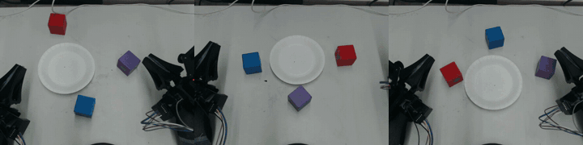
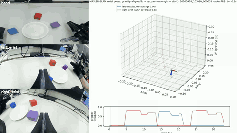

# Egocentric Human Demonstrations for Bimanual Cube Stacking

Can bimanual demonstrations recorded by a person wearing a hand-worn gripper train a dual-arm robot? **349 three-cube
stacking demonstrations → metric wrist poses → the robot's own relative-Cartesian action contract → X-VLA pretraining
on human data → fine-tuning on robot data → closed-loop execution on a reBot B601**, with every reported number
checked against its source record.

[](LICENSE)

Part of **[physical-ai-robot-learning](https://github.com/physical-ai-robot-learning)** — Physical AI / robot learning projects.

**Technical report:** [`report/report_en.pdf`](report/report_en.pdf) ([한국어](report/report_ko.pdf)) ·
**Results and dataset:** [`docs/results.md`](docs/results.md) ·
**Claims check:** `736 claims checked, 0 failed.` ([Code availability](#code-availability)) ·
**Hardware:** HandUMI is **BrikHMP18's open-source design** ([murobotics-ai/handumi-hw](https://github.com/murobotics-ai/handumi-hw)), **not ours**
([details](#hardware-source-handumi-is-not-our-design))



*Head-camera view of three recorded human demonstrations (2x speed): RBP (train), PRB (train), BPR (held-out). These are
human demonstrations with the hand-worn rig, not robot rollouts.*

## Result and status

| step | what happens |
|---|---|
| 1 · human demonstrations | 349 bimanual three-cube stacking episodes in 6 instructed stacking orders, recorded with two hand-worn grippers (wrist fisheye camera, IMU and a Feetech jaw-servo encoder for the gripper opening) and a fixed head camera |
| 2 · metric wrist poses | wrist-camera SLAM with a per-episode IMU visual–inertial scale; gripper, sync and quality gates |
| 3 · robot action representation | first pseudo-joint trajectories (Gen-1); from version 3 directly the robot's relative-Cartesian action contract (Gen-2) |
| 4 · learning | X-VLA pretrained on the human data, then fine-tuned on robot episodes; scratch baselines and a 30-episode low-data ablation |
| 5 · robot | checkpoints executed on the robot in closed loop (observed, not counted) |

**Key findings**

- **Offline result (Gen-1).** On 26 held-out episodes the 300k ego-pretrained model has a median TCP error of 1.5 / 5.7 mm
  (k=1 / k=30); the stacking instruction changes predictions but does not make them more accurate.
- **Ego pretrain → robot fine-tuning.** After 250k steps of R150 fine-tuning, the ego-initialised model beats scratch on most
  offline metrics (geo −10.0 %), but all 10 evaluation episodes are inside both fine-tuning sets, so this measures fit, not generalisation.
- **Transfer diagnostics (Gen-2).** Ego initialisation lowers early robot fine-tuning loss, and the advantage disappears
  with more steps; the ego-only policy does not transfer to robot camera images, and the gap is visual.
- **No closed-loop success rate** is reported anywhere in this repository (see [What this repository does not show](#what-this-repository-does-not-show)).

**Status: offline evaluation and training diagnostics.** Version-3 checkpoints were executed on the robot, and an
ego-initialized model fine-tuned on 312 robot episodes completed full three-cube stacks in closed loop (operator
observation; trials not counted, no video). This repository reports **no closed-loop success rate**.

Headline offline numbers (26 held-out episodes, final 300k checkpoint; dataset, split and model details in
[`docs/results.md`](docs/results.md)):

| | all arm-samples (798) | moving, TCP ≥ 20 mm by k=30 (187) |
|---|---|---|
| median TCP error, k=1 / k=30 | 1.5 / 5.7 mm | 11.2 / 39.9 mm |
| joint MAE k=30 (zero-motion predictor) | 0.97° (0.51°) | 6.59° (8.68°) |
| TCP direction cosine, k=30 | 0.81 | 0.90 |

### What this repository does not show

- No closed-loop success rate (three-cube stacking was observed with B300, but trials were not counted or recorded).
- No held-out or closed-loop comparison of ego-initialized vs scratch v3 models; the matched comparisons are training loss
  (312 episodes to 60k; 30 episodes to 300k).
- No success rate for the single-arm approach (Part II): robot sessions logged stop reasons, not outcomes.
- No transfer of the ego-only policy, or of the robotized wrist images, to robot cameras.
- No generalization to unseen cube layouts (layouts were not recorded) or to unseen stacking orders (all six are in training).
- No benefit on disjoint robot test data: the 10 % R150 gain is measured on episodes inside both fine-tuning sets.
- No transfer to other operators or scenes (one operator, one scene).

## Code availability

This public version contains documentation, the technical report and media only. The source code (HandUMI collector,
wrist-pose pipeline with MASt3R-SLAM and IMU metric scale, human-to-robot data builders, X-VLA training, robot
deployment) is not publicly released. Research access may be considered upon reasonable request (please open an
issue in this repository). Every number in the technical report was checked against its source file by a script
(`736 claims checked, 0 failed.`); that script is part of the non-public code.

The raw dataset, robot datasets and checkpoints are not published. Recording needs the HandUMI rig; MASt3R-SLAM and
training need a GPU node; deployment needs the robot.

## What is in this repository

- `README.md`: this page.
- [`report/`](report/): the technical report v5.2 as PDF, [English](report/report_en.pdf) and
  [한국어](report/report_ko.pdf), plus the earlier split documents in [`report/archive/`](report/archive/).
- [`media/`](media/): the demonstration GIF, the MASt3R-SLAM wrist-trajectory videos and the head-camera videos of
  three sample episodes.
- [`docs/`](docs/): results and dataset ([`docs/results.md`](docs/results.md)), release history
  ([`docs/history.md`](docs/history.md)), claims and number tables, operations notes, and the design notes, protocols and
  recipes of each stage (collector, CART20 conversion, training, deployment, single-arm sub-study).
- [`results/`](results/): the records behind the reported numbers (CSV / JSON / text summaries).
- [`hardware/`](hardware/): HandUMI build copy (upstream design by BrikHMP18) and our three modified parts.
- [`LICENSE`](LICENSE), [`LICENSES/`](LICENSES/) (HandUMI hardware licence and NOTICE), [`CITATION.cff`](CITATION.cff).

## What stage 1 produces: arm trajectories from wrist-camera SLAM



*One HRL80 stacking take (order PRB). Left: head camera and both wrist fisheye cameras. Right: MASt3R-SLAM wrist
trajectories of both arms, gravity-aligned (z up), each arm's origin at its start pose, metric scale from the IMU; below,
both grippers (1 = open). Full-resolution videos of three takes (PRB, RBP, PBR):
[`media/mast3r_trajectories/`](media/mast3r_trajectories/) (report Fig. 7). There is no robot-replay video for this
project; the closed-loop stacking runs were observed but not recorded.*

## Results, limitations and history

- Dataset, processing funnel, split, model, sample data, demonstration videos and the report list: [`docs/results.md`](docs/results.md).
- Results of every release (multi-seed retargeting and robot-like collection in v2; Cartesian ego pretraining and transfer
  diagnostics in v3; the R30 ablation and single-arm approach in v4) and the repository maps by release: [`docs/history.md`](docs/history.md).
- Limitations: [What this repository does not show](#what-this-repository-does-not-show) above and the report's Limitations section.

## Hardware and attribution

### Hardware source: HandUMI is not our design

The capture device is **HandUMI**, an open-source hand-worn UMI variant designed and published by **BrikHMP18**
(Apache-2.0). It is **not** our own UMI design.

| what | where | role |
|---|---|---|
| Original hardware design | [murobotics-ai/handumi-hw](https://github.com/murobotics-ai/handumi-hw) (first published as `robonet-ai/handumi-hw`, which now redirects) | the source of the design; we printed it from commit `e58de33` |
| Original software | [murobotics-ai/handumi-sw](https://github.com/murobotics-ai/handumi-sw) (formerly `robonet-ai/handumi-sw`) | we forked it at `33cc437` for an early path; the reported data were not recorded with it |
| Our build copy | [physical-ai-robot-learning/umihand](https://github.com/physical-ai-robot-learning/umihand) | the upstream print files and STEP/BOM as we used them, plus our own changes: 3 modified parts (`mods/`) and the wrist-IMU firmware |
| In this repository | [`hardware/`](hardware/), [`LICENSES/`](LICENSES/) (licence, NOTICE) | same build copy; the technical report, Sec. III, describes the upstream design and what we changed |

Our own contributions on the hardware side are limited to the three modified parts (connector, camera mount, servo
cover), the added Teensy 4.1 + ICM-42688-P wrist IMU that replaces upstream VR tracking, and the fixed head camera.

**Gripper signal.** The cube-stacking gripper labels come from the HandUMI **Feetech jaw servo read as an encoder**
(aperture 0.0675 m). The servos were off from 10-13 to 10-28 (laundry project) and were reinstalled
on 10-29 as torque-off jaw encoders ([egocentric-garment-manipulation](https://github.com/physical-ai-robot-learning/egocentric-garment-manipulation)).

## License, acknowledgements and citation

**License.** The documentation, records and media in this repository are licensed under the **PolyForm
Noncommercial License 1.0.0** ([LICENSE](LICENSE)): free for research, teaching, personal and other noncommercial use;
**commercial use is not permitted** without a separate written agreement with the author. Third-party parts keep their licences: the HandUMI
hardware files are Apache-2.0 ([`LICENSES/LICENSE-handumi-hw-apache-2.0.txt`](LICENSES/LICENSE-handumi-hw-apache-2.0.txt),
[`LICENSES/NOTICE-handumi.md`](LICENSES/NOTICE-handumi.md)).

**Acknowledgements.** HandUMI by BrikHMP18 ([murobotics-ai/handumi-hw](https://github.com/murobotics-ai/handumi-hw),
[murobotics-ai/handumi-sw](https://github.com/murobotics-ai/handumi-sw)); [MASt3R-SLAM](https://github.com/rmurai0610/MASt3R-SLAM);
[LeRobot](https://github.com/huggingface/lerobot) and X-VLA (`lerobot/xvla-base`);
[Universal Manipulation Interface](https://github.com/real-stanford/universal_manipulation_interface).

**Citation.** See [`CITATION.cff`](CITATION.cff):

```bibtex
@software{lee_egocentric_human_demonstrations_2026,
  author = {Lee, Jeong Hwan},
  title  = {Egocentric Human Demonstrations for Robot Manipulation},
  year   = {2026},
  url    = {https://github.com/physical-ai-robot-learning/egocentric-cube-stacking}
}
```
