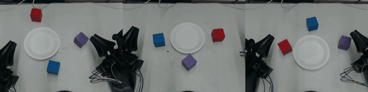
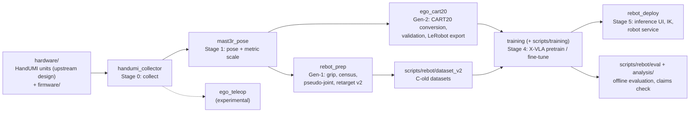

# Egocentric Human Demonstrations for Robot Manipulation

Bimanual human demonstrations recorded with a hand-worn UMI-style gripper (HandUMI), converted into training data for a
reBot B601 dual-arm robot and used to pretrain X-VLA, with every reported number re-checkable from this repository.

[](.github/workflows/ci.yml)
[](LICENSE)

Part of **[egocentric](https://github.com/physical-ai-vla/egocentric)** — the entry point to all egocentric-demonstration projects.

**Technical report:** [`report/report_en.pdf`](report/report_en.pdf) ([한국어](report/report_ko.pdf)) ·
**Claims check:** `python analysis/verify_claims.py` → `736 claims checked, 0 failed.` ([how](#results-and-how-to-verify)) ·
**Hardware:** HandUMI is **BrikHMP18's open-source design** ([murobotics-ai/handumi-hw](https://github.com/murobotics-ai/handumi-hw)), **not ours**
([details](#hardware-source-handumi-is-not-our-design))



## Overview

Research code, calibration, processing records and a small data sample from one experiment. We collected bimanual
human demonstrations with a hand-worn UMI-style gripper ([HandUMI](https://github.com/murobotics-ai/handumi-hw), not our
design; see [Hardware source](#hardware-source-handumi-is-not-our-design)), converted them into pseudo-joint trajectories
for a reBot B601 dual-arm robot, and used them to pretrain X-VLA. Version 3 (October 2026) replaces the joint-space
retargeting with a Cartesian conversion that matches the robot's own action contract, and tests what transfers to the
robot ([Update v3](docs/history.md#update-v3-cartesian-ego-pretraining-and-transfer)). Version 4 (7 October 2026) adds a 30-episode
low-data ablation and splits the write-up into two reports, each in English and Korean
([Update v4](docs/history.md#update-v4-two-reports-r30-ablation-and-single-arm-approach)). Version 5 (12 October 2026) merges everything
into **one technical report**: [`report/report_en.pdf`](report/report_en.pdf) ([한국어](report/report_ko.pdf)), 15 pages
covering hardware, every pipeline stage, all results and their limits, with no result changed. Earlier states are tagged
`report-v2-2026-09-30` and `report-v3-2026-10-04`.

- **Data path.** 349 recorded bimanual three-cube stacking episodes (6 stacking orders) go through sync, pose (MASt3R-SLAM +
  per-episode IMU visual–inertial scale), gripper and gate filtering and are turned into robot training data: first as
  pseudo-joint trajectories (Gen-1), then, from version 3, directly in the robot's relative-Cartesian action contract (Gen-2).
- **Offline result (Gen-1).** On 26 held-out episodes the 300k ego-pretrained model has a median TCP error of 1.5 / 5.7 mm
  (k=1 / k=30); the stacking instruction changes predictions but does not make them more accurate.
- **Ego pretrain → robot fine-tuning.** After 250k steps of R150 fine-tuning, the ego-initialised model beats scratch on most
  offline metrics (geo −10.0 %), but all 10 evaluation episodes are inside both fine-tuning sets, so this measures fit, not generalisation.
- **Transfer diagnostics (Gen-2).** Ego initialisation lowers early robot fine-tuning loss, and the advantage disappears
  with more steps; the ego-only policy does not transfer to robot camera images, and the gap is visual.
- **No closed-loop success rate** is reported anywhere in this repository (see [What this repository does not show](#what-this-repository-does-not-show)).

**Status: offline evaluation and training diagnostics.** Version-3 checkpoints were executed on the robot, and an
ego-initialized model fine-tuned on 312 robot episodes completed full three-cube stacks in closed loop (operator
observation; trials not counted, no video). This repository reports **no closed-loop success rate**.

## System at a glance



## Components

| Component | Path | Stage | Status | Description |
|---|---|---|---|---|
| hardware | [`hardware/`](hardware/), [`firmware/`](firmware/) | device | current | HandUMI print package from upstream (not our design), our 3 modified parts, wrist-IMU firmware (Teensy 4.1 / XIAO nRF52840) |
| handumi_collector | from the shared [`egocentric`](https://github.com/physical-ai-vla/egocentric) package | 0 collect | current | Raw recorder: head C922 + wrist fisheye/IMU/jaw → mp4 + `sensors.mcap`; calibration and QA tools; `robot_like_v1` protocol (guide: [`docs/collector/`](docs/collector/README.md)) |
| configs | [`configs/`](configs/) | all | current | Versioned calibrations, collector profiles, teleop configs; `dataset_calibration/` = the calibrations the reported dataset uses |
| mast3r_pose | [`src/mast3r_pose/`](src/mast3r_pose/) | 1 pose | current | Per-frame MASt3R-SLAM wrist pose and IMU-VI metric scale |
| rebot_prep | [`src/rebot_prep/`](src/rebot_prep/) | 2–3 dataset, retarget | superseded (by ego_cart20) | Gen-1: gripper width, census and gates, pseudo-joint continuity IK, retarget v2 with frozen contracts |
| ego_cart20 | [`src/ego_cart20/`](src/ego_cart20/) | 2 dataset | current | Gen-2: CART20 / RELCART20 conversion, jump filter, validators, LeRobot exporters, cube-PnP scale, right-only (HRA), robotize, UMI fusion |
| training | [`src/training/`](src/training/), [`scripts/training/`](scripts/training/) | 4 train | current | REL-only X-VLA plugin, UMI76/RELCART20 derivation and gates, reBot FK; node launchers and archivers; Gen-1 trainer in `scripts/training/c8old/` (superseded) |
| rebot_deploy | [`src/rebot_deploy/`](src/rebot_deploy/), [`scripts/rebot/loaders/`](scripts/rebot/loaders/) | 5 deploy | current | Inference core, robot web UI (PLAN / RTC / trial logger), Pink IK, MIT robot service, checkpoint loaders |
| evaluation | [`scripts/rebot/eval/`](scripts/rebot/eval/), [`analysis/`](analysis/) | 5 evaluate | current | Offline checkpoint evaluation and audits; `analysis/verify_claims.py` recomputes every reported number |
| hra | [`scripts/rebot/hra/`](scripts/rebot/hra/) | 1–5 (single arm) | current (sub-study) | Separate sub-study: right-arm approach to a cube (HRA_red, HRA_A100) — Part II of the report |
| ego_teleop | from the shared [`egocentric`](https://github.com/physical-ai-vla/egocentric) package | teleop | experimental | Wearable VIO teleop research; not deployed (notes: [`docs/experimental/`](docs/experimental/README.md)) |
| ego_collector | from the shared [`egocentric`](https://github.com/physical-ai-vla/egocentric) package | 0 collect | superseded (by handumi_collector) | V0 AprilTag-glove collector; its `camera` layer is still imported |
| report, results | [`report/`](report/), [`results/`](results/), [`docs/`](docs/) | — | current | Technical report (EN/KO, PDF + LaTeX), result records, guides and provenance |
| upstream | [`upstream/`](upstream/) | — | third-party | Licences, NOTICE and our patch on top of HandUMI software |

Each component has a README with its inputs/outputs, entry points and layout. The old → new path table for the
2026-11-01 restructure is in [`docs/provenance/README.md`](docs/provenance/README.md). `handumi_collector`,
`ego_collector`, `ego_teleop` and `umi` (the `umi.common.pose_util` stand-in) are also used by the garment project, so
since 2026-11-01 they live once in the shared package [`egocentric`](https://github.com/physical-ai-vla/egocentric) (v0.1.0), which `pyproject.toml` installs;
import names are unchanged, and their tests moved with them. Their guides, the configs and the data records stay here.

## Installation

```bash
git clone https://github.com/physical-ai-vla/egocentric-cube-stacking.git
cd egocentric-cube-stacking
pip install -e ".[collector,experimental,dev]"     # or: uv pip install -e ".[collector,experimental,dev]"; installs egocentric@v0.1.0
pytest tests/cart20 -q
python analysis/verify_claims.py                   # needs only pyyaml
```

The root `pyproject.toml` (src layout) declares the packages under `src/` and depends on the shared package
`egocentric @ git+https://github.com/physical-ai-vla/egocentric@v0.1.0`; extras (passed on to `egocentric`): `collector`
(devices, mcap, PySide6), `experimental` (mediapipe), `apriltag`, `viz`, `aero`, `dev`. Training and MASt3R-SLAM run in separate environments on GPU
nodes (LeRobot with X-VLA, MASt3R-SLAM checkout); see [Where each part ran](#running-it). Modules under `src/` use package
imports, so run them after `pip install -e .` (or with `PYTHONPATH=src`), e.g. `python -m ego_cart20.scripts.convert_dataset`.

## Pipeline

The stages below are the ones that produced the reported data. Commands are the existing entry points; most stage
scripts read and write the data roots of the machine they ran on (`~/c8`, `~/umi_bridge`, node paths).

| Stage | What | Entry points |
|---|---|---|
| 0 Collect | record HandUMI episodes (head C922 + wrist units) | `python -m handumi_collector.collect --hardware handumi_v1 --dataset Hpilot` (`--protocol robot_like_v1` for HRL80) |
| 1 Pose | export → per-frame MASt3R-SLAM → metric scale | `scripts/rebot/c8/c8_export.sh` (`scripts/umi_export_orbslam.py`), `scripts/rebot/mast3r/c8_run_5080.sh <side list> <out dir>` (`src/mast3r_pose/run_perframe.py`), scale `src/mast3r_pose/cp6_scale.py` (IMU-VI) or `src/ego_cart20/cube_pnp.py` (cube PnP) |
| 2 Dataset, Gen-2 | raw episodes → CART20 rows → validation → LeRobot | `python src/ego_cart20/sources/handumi_export.py --out <raw>`, `src/ego_cart20/scripts/convert_dataset.py <raw> <out>`, `validate_dataset.py <out>`, `export_lerobot.py <out> <lerobot>` |
| 2 Dataset, Gen-1 | gripper, census, Phase-3 segments, C-old builders | `src/rebot_prep/grip/c8_grip.py`, `src/rebot_prep/census/c8_census_pre.py`, `c8_phase3.py`, `scripts/rebot/dataset_v2/` builders and validators |
| 3 Retarget (Gen-1) | pseudo-joint continuity IK; multi-seed retarget v2 | `src/rebot_prep/pseudo_joint/pseudo_joint_pipeline.py`, `src/rebot_prep/retarget/v2k_retarget.py`, chains in `src/rebot_prep/retarget/chains/` |
| 4 Train | X-VLA pretrain on ego data, fine-tune on robot data | Gen-2: `scripts/training/ego_cart20/submit_ego_cart20v2.sh <gpu>`, `scripts/training/node4090/*.sh`, `scripts/training/node5090/*.sh` (`src/training/relonly/`); Gen-1: `scripts/training/c8old/c8old_chain.sh` |
| 5 Deploy / evaluate | serve a checkpoint on the robot; offline evaluation | `scripts/rebot/loaders/load_relonly_run_ckpt_to_ui.sh <step> [port]` (starts `src/rebot_deploy/mac_v4_smoke_ui.py`), `src/rebot_deploy/robot_service/robot_service_mit.py`; offline `scripts/rebot/eval/c8old/c8old_mac_eval.py`, `scripts/rebot/eval/rel16_audit/` |

Component guides with the full command lines: [`docs/collector/`](docs/collector/README.md),
[`docs/cart20/`](docs/cart20/README.md), [`docs/training/`](docs/training/README.md), [`docs/deploy/`](docs/deploy/README.md),
[`docs/hra/`](docs/hra/README.md).

## Codebase guide

**The split.** Importable code lives in `src/` as one package per concern (`mast3r_pose`, `rebot_prep`, `ego_cart20`,
`training`, `rebot_deploy`); the collector `handumi_collector`, the experimental `ego_teleop`, the superseded
`ego_collector` and `umi` come from the shared `egocentric` package. Command-line tools and machine-specific run bundles live in `scripts/`; configs and
calibrations in `configs/`; result records in `results/`; the claims checker and post-hoc analyses in `analysis/`.
Machine-specific data roots (`~/c8`, `~/umi_bridge`, `/home/bh-aiteam`, ...) are defined once in `src/ego_paths/` with
environment overrides (`EGO_DATA_ROOT`, ...; defaults = the original paths); `src/` does not edit `sys.path` except
through `ego_paths.prepend_sys_path` for external checkouts. Run bundles in `scripts/` keep their original bootstraps
and roots. Import rules, the import smoke test and split candidates: [`docs/code_structure.md`](docs/code_structure.md).

**The interfaces.**

| interface | definition | where it is defined |
|---|---|---|
| raw episode | per-stream mp4 + `sensors.mcap` (IMU, gripper, per-frame camera metadata, sync events), `episode_meta.json`, `events.json` | [`docs/collector/README.md`](docs/collector/README.md), [Sample data](#sample-data) |
| Gen-2 action (CART20) | 16 future poses `inv(T(t)) @ T(t + k·UMI_DT)`, k = 1..16, `UMI_DT` = 3/59.94 s (50.05 ms), so 0.80 s; per arm `[xyz, rot6d, g]`, LEFT first, grippers at dims 9 and 19; model action `[16, 32]` = CART20 + 12 exact zeros (AUX12) | [`src/ego_cart20/config.py`](src/ego_cart20/config.py), [`docs/cart20/README.md`](docs/cart20/README.md) |
| Gen-2 state (RELCART20) | each arm's pose relative to its task start, `[L pose9, R pose9, gL, gR]` (20-D); rows stored at 15 Hz | same |
| rotation | rot6d = first two **rows** of R (UMI `mat_to_rot6d`); quaternions are wxyz | same |
| gripper (ego labels) | continuous aperture, 0 = closed, 1 = open (aperture / 80 mm); source = the HandUMI **Feetech jaw servo encoder** for the cube-stacking data (`src/rebot_prep/grip/`), wrist video only while the servos were off (10-13 → 10-28), servo encoder again from 10-29 | same |
| gripper (reBot raw) | raw 0 = CLOSED, −270 = OPEN; commands 0..45 with raw = −6·cmd | [`docs/OPERATIONS_NOTES.md`](docs/OPERATIONS_NOTES.md) |
| Gen-1 action | Δq_pseudo chunk `q[t+5+i] − q[t]`, i = 0..29 (LEAD 5, 30 steps), on 65-frame segments | [`scripts/training/c8old/humanik_delta.py`](scripts/training/c8old/humanik_delta.py) |
| frames | dataset TCP and the `eef_kin` FK TCP differ by R_y(90°); the IK TCP is `gripper_link` + 0.07 m along x | [`docs/OPERATIONS_NOTES.md`](docs/OPERATIONS_NOTES.md) |
| X-VLA domain id | only base slots 10–17 were pretrained; our embodiment uses slot 20 | [`docs/OPERATIONS_NOTES.md`](docs/OPERATIONS_NOTES.md) |
| data contracts (node side) | UMI76 and RELCART20 contracts | [`src/training/umi76/UMI76_CONTRACT.md`](src/training/umi76/UMI76_CONTRACT.md), [`RELCART20_CONTRACT.md`](src/training/umi76/RELCART20_CONTRACT.md), [`docs/training/UMI_XVLA_CONTRACT.md`](docs/training/UMI_XVLA_CONTRACT.md) |

## Results and how to verify

`analysis/verify_claims.py` recomputes every number in the report and in this README from files in this repository and
fails on any mismatch:

```bash
python analysis/verify_claims.py      # prints "736 claims checked, 0 failed."; exits 1 on any mismatch
python analysis/verify_claims.py --md analysis/out/claim_audit.md   # also writes the per-claim table
```

The per-claim table (section, claim, report value, recomputed value, evidence file, status) is
[`analysis/out/claim_audit.md`](analysis/out/claim_audit.md). Other reproduction commands:

```bash
python3 analysis/verify_claims.py --md analysis/out/claim_audit.md   # needs pyyaml; exits 1 on any mismatch
python3 analysis/paired_bootstrap_r150.py                            # R150 250k episode-level bootstrap
python3 analysis/v3/ego_init_loss_compare.py                         # v3 matched initialization comparison
python3 analysis/v4_r30_ablation.py && python3 analysis/v4_hra_summary.py   # v4 numbers + Figs. 8-9 (need matplotlib)
python3 report/figures/make_figures.py && python3 report/figures/make_figures_v3.py
cd report && for f in part1_stacking_en part1_stacking_ko part2_approach_en part2_approach_ko methods_en methods_ko; do tectonic $f.tex; done   # full versions: cd archive
# the Korean reports use xeCJK with the macOS fonts AppleMyungjo / Apple SD Gothic Neo
```

### Reports

| Report | English | 한국어 | Full-length version |
|---|---|---|---|
| **Technical report (v5, one document, 15 pp)** | [`report/report_en.pdf`](report/report_en.pdf) | [`report/report_ko.pdf`](report/report_ko.pdf) | (is the full report) |
| Part I: three-cube stacking (bimanual), 4 pp | [`report/part1_stacking_en.pdf`](report/part1_stacking_en.pdf) | [`report/part1_stacking_ko.pdf`](report/part1_stacking_ko.pdf) | `report/archive/part1_stacking_{en,ko}_full.pdf` (11 pp, v4.1) |
| Part II: single-arm approach to a cube, 2 pp | [`report/part2_approach_en.pdf`](report/part2_approach_en.pdf) | [`report/part2_approach_ko.pdf`](report/part2_approach_ko.pdf) | `report/archive/part2_approach_{en,ko}_full.pdf` (5 pp) |
| Methods and pipeline (how every stage works), 6 pp | [`report/methods_en.pdf`](report/methods_en.pdf) | [`report/methods_ko.pdf`](report/methods_ko.pdf) | — |

The v5 technical report is the main document. The earlier split documents remain: short versions in `report/`, full-length
versions in `report/archive/`. LaTeX
sources sit next to the PDFs; figures are rebuilt by `report/figures/make_figures*.py`, `analysis/v4_r30_ablation.py` and
`analysis/v4_hra_summary.py`. The v3 single report is also in `report/archive/`. `analysis/verify_claims.py` also checks that every value required in the full-length reports appears in the v5 report.
All reports now cite the upstream HandUMI hardware repository.
The Part I full version 4.1 (2026-10-12) adds Sec. III, *HandUMI hardware*: the upstream HandUMI project (murobotics-ai/handumi-hw by BrikHMP18,
formerly robonet-ai; we built `e58de33` and forked handumi-sw at `33cc437`, the fork not used for the reported data), print and electronics, our deviations (no VR tracking, added Teensy 4.1 + ICM-42688-P wrist IMU, fixed-focus head
C922), our three modified parts (Fig. 2, `report/figures/make_fig10_handumi_mods.py`) and device-identity pitfalls. The hardware
files are in `hardware/` and in our build copy [`physical-ai-vla/umihand`](https://github.com/physical-ai-vla/umihand); the design itself is
upstream [murobotics-ai/handumi-hw](https://github.com/murobotics-ai/handumi-hw).

### Demonstration videos


Head-camera view of three recorded human demonstrations (2x speed). Left to right: RBP (train), PRB (train),
BPR (held-out validation episode). Full-length videos (640x480, 30 fps, 23 s, no audio):

| Episode | Order (bottom → top) | Split | Video |
|---|---|---|---|
| `20260917_150545_000001` | red, blue, purple | train | [head.mp4](sample_data/20260917_150545_000001/head.mp4) |
| `20260917_150545_000005` | purple, red, blue | train | [head.mp4](sample_data/20260917_150545_000005/head.mp4) |
| `20260917_150545_000010` | blue, purple, red | held-out | [head.mp4](sample_data/20260917_150545_000010/head.mp4) |

**MASt3R-SLAM wrist trajectories** (v3): head + both wrist cameras, gravity-aligned 3D wrist trajectory and gripper
trace. Details in [MASt3R-SLAM trajectory videos](docs/history.md#mast3r-slam-trajectory-videos).

| Video | Take | Metric scale |
|---|---|---|
| [hrl80_000035_wrist.mp4](media/mast3r_trajectories/hrl80_000035_wrist.mp4) | HRL80 bimanual stacking, PRB, 33 s | IMU-VI |
| [hrl80_000055_wrist.mp4](media/mast3r_trajectories/hrl80_000055_wrist.mp4) | HRL80 bimanual stacking, RBP, 33 s | IMU-VI |
| [hrl80_000060_wrist.mp4](media/mast3r_trajectories/hrl80_000060_wrist.mp4) | HRL80 bimanual stacking, PBR, 33 s | IMU-VI |

These are human demonstrations recorded with the hand-worn rig, not robot rollouts. Wrist-camera videos are not
published (see [Sample data](#sample-data)).

### Dataset

- **Task:** stacking three cubes (red, blue, purple) on a plate, in 6 stacking orders (RBP, RPB, BRP, BPR, PRB, PBR).
  The instruction text is `Stack the {bottom} cube on the bottom, {middle} cube in the middle, and {top} cube on the top, on the plate.`
- **Rig:** each hand wears a HandUMI unit with a wrist fisheye camera (1080p, 30 fps), a Teensy IMU (200 Hz) and a
  Feetech jaw encoder. A fixed C922 head camera (640x480, 30 fps) looks down at the table.
- **Processing funnel:**
  - 349 recorded episodes
  - 284 pass sync (left wrist is the master clock; the right wrist and head must be within 20 ms)
  - 259 source episodes remain after pose, gripper and gate filtering
  - 561 bimanual segments of 65 frames each
- **Pose:** MASt3R-SLAM gives the RGB-only wrist-camera pose. Metric scale comes from a per-episode IMU visual-inertial
  fit (`cp6_scale.imu_vi`). On a separate 14-episode ArUco benchmark (10 tracks held out) the scale error is
  4.6 / 17.0 % (p50 / p90) and the 16-step relative position error p90 is 11.3 mm (`results/pose_benchmark/`). The camera-to-TCP transform is `handumi_camera_tcp_v2`.
- **Retargeting:** trajectories are anchored at the robot start pose and retargeted to reBot B601 pseudo-joints with
  continuity IK. Segments then pass workspace, metric and IK gates (an inter-arm clearance check is used only in
  retargeting v2). Sessions with inconsistent
  IMU and camera rotation are quarantined (`results/c8_quarantine.json`).
- **Split:** by source episode, never by segment. `numpy.random.default_rng(0)` gives 233 train episodes (504 segments)
  and 26 held-out episodes (57 segments). See `results/split_index.json`.
- **Model:** X-VLA (879M parameters), initialised from `lerobot/xvla-base`, pretrained for 300k steps on the ego set. Loss terms:
  - Main target: a Δq_pseudo action chunk, `q[t+5+i] - q[t]` for i = 0..29 (LEAD 5, 30 steps). It is defined in `scripts/training/c8old/humanik_delta.py`.
  - EEF auxiliary loss on relative TCP xyz (`XVLA_EE_AUX`).
  - FK-consistency loss.
- **Evaluation:** offline, on the 26 held-out episodes. Metrics are joint MAE against a zero-action baseline, FK
  position error, direction cosine and a collapse ratio. The checkpoint selection rule was registered before any
  results (`geo_score`); a second, motion-gated selector was added post hoc and is labelled as such
  (`results/selection.json`).

The held-out set is a random 10% of source episodes. It is not balanced by order or by session, and the cube layouts
were not systematically randomised. None of the results here are claims about generalisation.

### Sample data

`sample_data/<session>_<episode>/` holds three episodes from session `Hpilot_20260917_150545`:

| id | order | split |
|---|---|---|
| `20260917_150545_000010` | BPR | held-out (val) |
| `20260917_150545_000001` | RBP | train |
| `20260917_150545_000005` | PRB | train |

Each episode directory contains:

- `episode_meta.json`, `events.json`
- `sensors.mcap`: IMU, gripper, per-frame camera metadata and sync events
- `head.mp4`: head camera, re-muxed video-only
- `derived/pose_mast3r_filtered/`: per-side camera/TCP pose parquet files, canonical table and pose QA
- `segments_<id>.npz`: the processed 65-frame segments. Keys are `starts, st, ac, tcp_tgt, vfL, vfR, vfH, epd, instr, val`. `epd` is the episode path relative to the raw dataset root (`Hpilot/<session>/<episode>`).
- `right_wrist_frame.jpg`: one 640 px frame from the right wrist camera. It was checked by eye to show only the tabletop, cubes, plate and HandUMI hardware.

The sample episodes ship the head video only; wrist fisheye views of three HRL80 takes are shown in the
[MASt3R-SLAM trajectory videos](docs/history.md#mast3r-slam-trajectory-videos).

### Key results (offline, 26 held-out episodes, final 300k checkpoint)

| | all arm-samples (798) | moving, TCP ≥ 20 mm by k=30 (187) |
|---|---|---|
| median TCP error, k=1 / k=30 | 1.5 / 5.7 mm | 11.2 / 39.9 mm |
| joint MAE k=30 (zero-motion predictor) | 0.97° (0.51°) | 6.59° (8.68°) |
| TCP direction cosine, k=30 | 0.81 | 0.90 |

- Aggregate errors are dominated by static phases; on static samples the policy predicts spurious motion.
- Prompt swap: the 6 order instructions move the k=30 prediction by 4.8 mm (≈8 % of the 62 mm predicted displacement),
  and the true instruction is no closer to the recorded motion than a wrong one (mean rank 3.55 of 6, chance 3.5).
  The instruction measurably changes predictions but does not make them more accurate.

### Release history

The results added by each release (multi-seed retargeting, robot-like collection and fine-tuning in v2; Cartesian ego
pretraining and transfer diagnostics in v3; the R30 ablation and single-arm approach in v4) and the repository maps of
every release are in [`docs/history.md`](docs/history.md):
[Update v2](docs/history.md#update-v2-multi-seed-retargeting-robot-like-collection-combined-dataset) ·
[Update v3](docs/history.md#update-v3-cartesian-ego-pretraining-and-transfer) ·
[Update v4](docs/history.md#update-v4-two-reports-r30-ablation-and-single-arm-approach) ·
[Repository maps](docs/history.md#repository-maps-by-release-historical).

### What this repository does not show

- No closed-loop success rate (three-cube stacking was observed with B300, but trials were not counted or recorded).
- No held-out or closed-loop comparison of ego-initialized vs scratch v3 models; the matched comparisons are training loss
  (312 episodes to 60k; 30 episodes to 300k).
- No success rate for the single-arm approach (Part II): robot sessions logged stop reasons, not outcomes.
- No transfer of the ego-only policy, or of the robotized wrist images, to robot cameras.
- No generalization to unseen cube layouts (layouts were not recorded) or to unseen stacking orders (all six are in training).
- No benefit on disjoint robot test data: the 10 % R150 gain is measured on episodes inside both fine-tuning sets.
- No transfer to other operators or scenes (one operator, one scene).

## Current vs superseded

| current | superseded (kept in the repository; see [`legacy/`](legacy/README.md)) |
|---|---|
| Gen-2 Cartesian CART20 / RELCART20 data (`src/ego_cart20/`, report v3+) | Gen-1 pseudo-joint retargeting (`src/rebot_prep/pseudo_joint/`, `census/c8_phase3.py`) |
| retarget v2-TR + frozen hybrid master (`src/rebot_prep/retarget/`) | v1 single-anchor retarget; v2-K / v2-Kr variants |
| C-old v2 dataset builders (`scripts/rebot/dataset_v2/`) | C-old v1 builder (`legacy/c8old_dataset_v1/`) |
| REL-only X-VLA training (`src/training/relonly/`) | Gen-1 trainer and chain (`scripts/training/c8old/`, `scripts/rebot/eval/c8old/`) |
| `handumi_collector` (shared `egocentric` package) | V0 AprilTag collector `ego_collector` (shared `egocentric` package; camera layer still used) |
| `scripts/rebot/loaders/load_*_ckpt_to_ui.sh` | `legacy/loaders/` |
| one technical report `report/report_{en,ko}` (v5) | split reports `report/part*`, `report/methods_*`, `report/archive/` |

`ego_teleop` (shared `egocentric` package) is experimental (not deployed). After the v5 report (2026-10-12) the HandUMI work moved to T-shirt
flattening; that project, including the material formerly kept here (`scripts/rebot/laundry/`, `scripts/rebot/parity/`,
`src/visual_teleop/`, `scripts/umi_teleop_eval/`), lives in [egocentric-garment-manipulation](https://github.com/physical-ai-vla/egocentric-garment-manipulation).
Item-by-item table: [`docs/provenance/README.md`](docs/provenance/README.md#superseded-items-kept-not-deleted).

Conventions: lengths in the CART20 contract are metres (`*_m` fields in `src/ego_cart20/config.py`); frames, gripper signs and other
pitfalls are collected in [`docs/OPERATIONS_NOTES.md`](docs/OPERATIONS_NOTES.md).

## Hardware and attribution

### Hardware source: HandUMI is not our design

The capture device is **HandUMI**, an open-source hand-worn UMI variant designed and published by **BrikHMP18**
(Apache-2.0). It is **not** our own UMI design.

| what | where | role |
|---|---|---|
| Original hardware design | [murobotics-ai/handumi-hw](https://github.com/murobotics-ai/handumi-hw) (first published as `robonet-ai/handumi-hw`, which now redirects) | the source of the design; we printed it from commit `e58de33` |
| Original software | [murobotics-ai/handumi-sw](https://github.com/murobotics-ai/handumi-sw) (formerly `robonet-ai/handumi-sw`) | we forked it at `33cc437` for an early path; the reported data were not recorded with it |
| Our build copy | [physical-ai-vla/umihand](https://github.com/physical-ai-vla/umihand) | the upstream print files and STEP/BOM as we used them, plus our own changes: 3 modified parts (`mods/`) and the wrist-IMU firmware |
| In this repository | [`hardware/`](hardware/), [`upstream/`](upstream/) (licence, NOTICE, our patch) | same build copy; the technical report, Sec. III, describes the upstream design and what we changed |

Our own contributions on the hardware side are limited to the three modified parts (connector, camera mount, servo
cover), the added Teensy 4.1 + ICM-42688-P wrist IMU that replaces upstream VR tracking, and the fixed head camera.

**Gripper signal.** The cube-stacking gripper labels come from the HandUMI **Feetech jaw servo read as an encoder**
(`src/rebot_prep/grip/`, aperture 0.0675 m). The servos were off from 10-13 to 10-28 (laundry project) and were reinstalled
on 10-29 as torque-off jaw encoders ([egocentric-garment-manipulation](https://github.com/physical-ai-vla/egocentric-garment-manipulation)).

### Running it

This is research code from a single lab environment. Absolute hostnames, IPs, user names and home paths have
been replaced with placeholders: `${HOME}`, `${REMOTE_HOME}`, `${DATA_ROOT}`, `${SHARED_ROOT}`, `<gpu-node>`,
`<ray-head>`. Many scripts still assume the original directory layout (`~/c8`, `~/umi_bridge`, `~/ego_collector`); in
`src/` these roots come from `ego_paths` and can be redirected with environment variables ([`docs/code_structure.md`](docs/code_structure.md)).
Where each part ran:

- **Collection:** macOS laptop (PySide6, AVFoundation/UVC, `uvc-util`). Entry point `python -m handumi_collector.collect`, run from the repository root.
- **Export, gripper, census, dataset build, offline eval:** CPU / Apple MPS.
- **MASt3R-SLAM:** one RTX 5080 (16 GB), with the upstream repo patched by `build_compat_5090.patch`.
- **Training:** one RTX 4090, submitted as a Ray job, fp32 with TF32 matmuls, batch 4.

Upstream dependencies (not vendored unless noted):

- LeRobot with X-VLA: <https://github.com/huggingface/lerobot>. The base weights are `lerobot/xvla-base` on the Hugging Face Hub.
- MASt3R-SLAM: <https://github.com/rmurai0610/MASt3R-SLAM>. The pinned commit is in `src/mast3r_pose/INSTALLED_COMMIT` and the checkpoint MD5s are in `MD5SUMS`.
- Universal Manipulation Interface (`umi.common.pose_util`): <https://github.com/real-stanford/universal_manipulation_interface> (MIT). A stand-in with the same API is in the shared `egocentric` package as `umi` ([`upstream/README.md`](upstream/README.md)).
- Python packages: `mcap`, `numpy`, `scipy`, `opencv-python`, `av`, `pandas`, `pyarrow`, `torch`, `pyyaml`, `PySide6`, `pyserial`, `scservo_sdk` (Feetech).

Not included (these live in other internal packages):

- `ego_collector.camera.capture` / `orbbec_capture`: the camera capture backend imported by `handumi_collector/devices/camera.py` (listed here before the full code was added on 2026-10-07; now `ego_collector/camera/` in the shared `egocentric` package).
- `handumi_collector.tools.pose_process`, `pose.run` and `pose.backends`: the legacy offline VO pipeline. `tools/camera_imu_offset.py` imports `pose_process.episodes_under`.
- `handumi.robots` (the `rebot_b601` embodiment and IK solver): imported by `src/rebot_prep/pseudo_joint/eef_kin.py`.
- `umi_bridge/track_c/data/r150_q_tcp.npz`, the robot reference joint/TCP data used by `c8_phase3.py`, and the R150 robot dataset used by the fine-tune stage of `c8old_chain.sh`.
- The legacy gripper anchor file `gripper_contract.json` read by `c8_grip.py`. `src/rebot_prep/grip/correct_grip.py` gives the rule it was derived from (aperture 0.0675 m).
- `umi_export_orbslam.py` expects `handumi_collector` and `configs/calibration` relative to its parent directory. `scripts/umi_export_orbslam.py` finds `configs/calibration/` at the repository root and `handumi_collector` in `src/`; the copy in `scripts/rebot/c8/` keeps the original lookup.
- `train_bi.py` imports `eef_delta.py` unconditionally. A copy is included, but it stays inactive unless `EEF_DELTA=1`, which the chain never sets.

### Not included

- `src/training/robot/reBot_B601_DM_dualarm.urdf` (vendor robot model) and `src/mast3r_pose/build_compat_5090.patch`
  (a diff against MASt3R-SLAM) are withheld until their licences are confirmed. The FK code in `src/training/robot/`
  expects the URDF at that path.
- Part II (v4) processing code for HRA_A100 (origin-plane scale, origin-yaw matching, G-frame calibration, the table-aware
  conversion and the robot-camera re-rendering) lives in internal tooling and is not included; its outputs and per-take
  reports are in `results/v4/hra/`.

## License, acknowledgements and citation

**License.** Code, documentation, data samples and media in this repository are licensed under the **PolyForm
Noncommercial License 1.0.0** ([LICENSE](LICENSE)): free for research, teaching, personal and other noncommercial use;
**commercial use is not permitted** without a separate written agreement with the author. Third-party parts keep their licences: HandUMI
hardware and software are Apache-2.0 (`upstream/LICENSE-handumi-hw-apache-2.0.txt`, `upstream/LICENSE-handumi-apache-2.0.txt`,
`upstream/NOTICE.md`); the Aero Hand Open URDFs are Apache-2.0 (`assets/aero_hand_open/NOTICE`).

**Acknowledgements.** HandUMI by BrikHMP18 ([murobotics-ai/handumi-hw](https://github.com/murobotics-ai/handumi-hw),
[murobotics-ai/handumi-sw](https://github.com/murobotics-ai/handumi-sw)); [MASt3R-SLAM](https://github.com/rmurai0610/MASt3R-SLAM);
[LeRobot](https://github.com/huggingface/lerobot) and X-VLA (`lerobot/xvla-base`);
[Universal Manipulation Interface](https://github.com/real-stanford/universal_manipulation_interface).

**Citation.** See [`CITATION.cff`](CITATION.cff):

```bibtex
@software{lee_egocentric_human_demonstrations_2026,
  author = {Lee, Jeong Hwan},
  title  = {Egocentric Human Demonstrations for Robot Manipulation},
  year   = {2026},
  url    = {https://github.com/physical-ai-vla/egocentric-cube-stacking}
}
```
