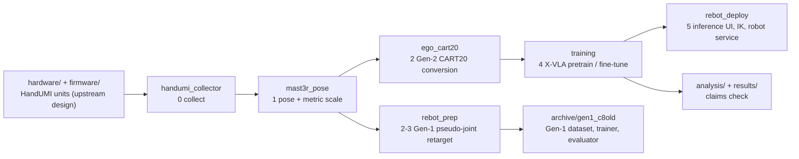
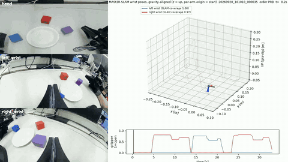

# Egocentric Human Demonstrations for Bimanual Cube Stacking

Can bimanual demonstrations recorded by a person wearing a hand-worn gripper train a dual-arm robot? **349 three-cube
stacking demonstrations → metric wrist poses → the robot's own relative-Cartesian action contract → X-VLA pretraining
on human data → fine-tuning on robot data → closed-loop execution on a reBot B601**, with every reported number
re-checkable from this repository.

[](.github/workflows/ci.yml)
[](LICENSE)

Part of **[physical-ai-robot-learning](https://github.com/physical-ai-robot-learning)** — Physical AI / robot learning projects.

**Technical report:** [`report/report_en.pdf`](report/report_en.pdf) ([한국어](report/report_ko.pdf)) ·
**Results and dataset:** [`docs/results.md`](docs/results.md) ·
**Claims check:** `python analysis/verify_claims.py` → `736 claims checked, 0 failed.` ·
**Hardware:** HandUMI is **BrikHMP18's open-source design** ([murobotics-ai/handumi-hw](https://github.com/murobotics-ai/handumi-hw)), **not ours**
([details](#hardware-source-handumi-is-not-our-design))


*Head-camera view of three recorded human demonstrations (2x speed): RBP (train), PRB (train), BPR (held-out). These are
human demonstrations with the hand-worn rig, not robot rollouts.*

## Result and status

| step | what happens |
|---|---|
| 1 · human demonstrations | 349 bimanual three-cube stacking episodes in 6 instructed stacking orders, recorded with two hand-worn grippers (wrist fisheye camera, IMU and a Feetech jaw-servo encoder for the gripper opening) and a fixed head camera |
| 2 · metric wrist poses | wrist-camera SLAM with a per-episode IMU visual–inertial scale; gripper, sync and quality gates |
| 3 · robot action representation | first pseudo-joint trajectories (Gen-1); from version 3 directly the robot's relative-Cartesian action contract (Gen-2) |
| 4 · learning | X-VLA pretrained on the human data, then fine-tuned on robot episodes; scratch baselines and a 30-episode low-data ablation |
| 5 · robot | checkpoints executed on the robot in closed loop (observed, not counted) |

**Key findings**

- **Offline result (Gen-1).** On 26 held-out episodes the 300k ego-pretrained model has a median TCP error of 1.5 / 5.7 mm
  (k=1 / k=30); the stacking instruction changes predictions but does not make them more accurate.
- **Ego pretrain → robot fine-tuning.** After 250k steps of R150 fine-tuning, the ego-initialised model beats scratch on most
  offline metrics (geo −10.0 %), but all 10 evaluation episodes are inside both fine-tuning sets, so this measures fit, not generalisation.
- **Transfer diagnostics (Gen-2).** Ego initialisation lowers early robot fine-tuning loss, and the advantage disappears
  with more steps; the ego-only policy does not transfer to robot camera images, and the gap is visual.
- **No closed-loop success rate** is reported anywhere in this repository (see [What this repository does not show](#what-this-repository-does-not-show)).

**Status: offline evaluation and training diagnostics.** Version-3 checkpoints were executed on the robot, and an
ego-initialized model fine-tuned on 312 robot episodes completed full three-cube stacks in closed loop (operator
observation; trials not counted, no video). This repository reports **no closed-loop success rate**.

Headline offline numbers (26 held-out episodes, final 300k checkpoint; dataset, split and model details in
[`docs/results.md`](docs/results.md)):

| | all arm-samples (798) | moving, TCP ≥ 20 mm by k=30 (187) |
|---|---|---|
| median TCP error, k=1 / k=30 | 1.5 / 5.7 mm | 11.2 / 39.9 mm |
| joint MAE k=30 (zero-motion predictor) | 0.97° (0.51°) | 6.59° (8.68°) |
| TCP direction cosine, k=30 | 0.81 | 0.90 |

### What this repository does not show

- No closed-loop success rate (three-cube stacking was observed with B300, but trials were not counted or recorded).
- No held-out or closed-loop comparison of ego-initialized vs scratch v3 models; the matched comparisons are training loss
  (312 episodes to 60k; 30 episodes to 300k).
- No success rate for the single-arm approach (Part II): robot sessions logged stop reasons, not outcomes.
- No transfer of the ego-only policy, or of the robotized wrist images, to robot cameras.
- No generalization to unseen cube layouts (layouts were not recorded) or to unseen stacking orders (all six are in training).
- No benefit on disjoint robot test data: the 10 % R150 gain is measured on episodes inside both fine-tuning sets.
- No transfer to other operators or scenes (one operator, one scene).

## Repository map

| path | what | read this if… |
|---|---|---|
| [`src/handumi_collector/`](src/handumi_collector/) (+ [`src/ego_collector/`](src/ego_collector/) camera layer) | stage 0: raw recorder for the HandUMI rig, calibration and QA tools | you want to know how a demonstration is recorded and synchronised |
| [`src/mast3r_pose/`](src/mast3r_pose/) | stage 1: episode export, per-frame MASt3R-SLAM wrist pose, IMU visual–inertial metric scale | you want to know where the metric wrist trajectories come from |
| [`src/ego_cart20/`](src/ego_cart20/) | stage 2 (Gen-2, current): human episodes → the robot's CART20 action / RELCART20 state contract, validation, LeRobot export | you want the conversion from human motion to robot training data |
| [`src/rebot_prep/`](src/rebot_prep/) | stages 2–3 (Gen-1, superseded): gripper width, census and gates, pseudo-joint continuity IK, multi-seed retarget v2 | you want the joint-space path behind the Gen-1 numbers |
| [`src/training/`](src/training/) | stage 4: X-VLA REL-only loss plugin for LeRobot, UMI76 / RELCART20 dataset derivation and gates, reBot FK | you want the training objective and the robot-dataset contracts |
| [`src/rebot_deploy/`](src/rebot_deploy/) | stage 5: inference core, robot web UI / controller, Pink IK, MIT robot service | you want to see how a checkpoint drives the robot |
| [`src/ego_paths/`](src/ego_paths/), [`src/umi/`](src/umi/) | machine-specific data roots (env-overridable); UMI `pose_util` stand-in | you run anything outside the original machines |
| [`scripts/`](scripts/) | launchers only (GPU nodes, MASt3R-SLAM GPU, robot computer), by stage | you want the exact launch record of a run |
| [`configs/`](configs/) | calibrations (`dataset_calibration/` = those the reported dataset used), collector hardware profiles | you check a calibration value |
| [`analysis/`](analysis/), [`results/`](results/) | claims checker and post-hoc analyses; the records behind every number | you want to re-check a number |
| [`report/`](report/) | technical report v5.2 (EN / KO, LaTeX + PDF) | you want the full write-up |
| [`docs/`](docs/) | results and dataset, history, component guides, conventions, refactor log | you need detail beyond this page |
| [`tests/`](tests/) | repository-level tests: CART20 contract, collector, UI golden record, import smoke test (package tests are in `src/<pkg>/tests/`) | you change code |
| [`hardware/`](hardware/), [`firmware/`](firmware/), [`upstream/`](upstream/) | HandUMI build copy (upstream design) + our 3 modified parts, wrist-IMU firmware, third-party licences and our patch | you build the rig |
| [`assets/`](assets/), [`media/`](media/) | three sample episodes; GIF and trajectory videos | you want to look at real data |
| [`archive/`](archive/README.md) | superseded and exploratory code kept verbatim (Gen-1 trainer and evaluator, single-arm sub-study, audits, V0 collector, teleop) | you trace an older result |

**Start reading here:** [`src/ego_cart20/convert.py`](src/ego_cart20/convert.py) (one human episode → robot training rows),
[`src/ego_cart20/config.py`](src/ego_cart20/config.py) (the frozen action / state contract) and
[`src/training/relonly/rel16_aux_relonly.py`](src/training/relonly/rel16_aux_relonly.py) (the REL-only training loss),
then [`src/rebot_deploy/xvla_inference.py`](src/rebot_deploy/xvla_inference.py) (how a predicted chunk becomes robot commands).



## Pipeline

The stages that produced the reported data. Modules run as `python -m <package>.<module>` after `pip install -e .`; most
read and write the data roots of the machine they ran on (`~/c8`, `~/umi_bridge`, node paths; see `src/ego_paths/`).

| # | stage | module | command |
|---|---|---|---|
| 0 | record HandUMI episodes (head C922 + wrist units) | `handumi_collector` | `python -m handumi_collector.collect --hardware handumi_v1 --dataset Hpilot` (`--protocol robot_like_v1` for HRL80) |
| 1a | export one episode side for SLAM | `mast3r_pose.export_episode` | `python -m mast3r_pose.export_episode <episode> {left,right} <out>` (batch: `scripts/pose/c8_export.sh`) |
| 1b | per-frame MASt3R-SLAM wrist pose (GPU) | `mast3r_pose.run_perframe` | `scripts/pose/c8_run_5080.sh <side list> <out dir>` |
| 1c | metric scale | `mast3r_pose.imu_metric_scale` (IMU-VI), `ego_cart20.cube_pnp` (cube PnP) | `python -m mast3r_pose.imu_metric_scale` |
| 2 | Gen-2: raw episodes → CART20 rows → validation → LeRobot | `ego_cart20` | `python -m ego_cart20.handumi_export --out <raw>`, `python -m ego_cart20.scripts.convert_dataset <raw> <out>`, `… .validate_dataset <out>`, `… .export_lerobot <out> <lerobot>` |
| 2–3 | Gen-1: gripper, census, Phase-3 segments, continuity IK, retarget v2 | `rebot_prep` | `python -m rebot_prep.grip.grip_census`, `… .census.sensor_sync_census`, `… .census.phase3_segments`, `… .retarget.multi_seed_retarget` (chains: `scripts/dataset/gen1_retarget/`); C-old builders in `archive/gen1_c8old/` |
| 4 | X-VLA pretrain on ego data, fine-tune on robot data | `training.relonly`, `training.umi76` | node launchers `scripts/train/node4090/*.sh`, `scripts/train/node5090/*.sh`, submit `scripts/train/ego_cart20/submit_ego_cart20v2.sh <gpu>` |
| 5 | serve a checkpoint on the robot | `rebot_deploy` | `scripts/deploy/load_relonly_run_ckpt_to_ui.sh <step> [port]` (starts `python -m rebot_deploy.run_smoke_ui`); robot side `src/rebot_deploy/robot_service/robot_service_mit.py` |
| — | re-check every reported number | `analysis/verify_claims.py` | `python analysis/verify_claims.py` |

Component guides with full command lines: [`docs/collector/`](docs/collector/README.md), [`docs/cart20/`](docs/cart20/README.md),
[`docs/training/`](docs/training/README.md), [`docs/deploy/`](docs/deploy/README.md), [`docs/hra/`](docs/hra/README.md) (single-arm
sub-study). Data interfaces (raw episode, CART20, RELCART20, rotation and gripper conventions, frames) and the machine-specific
roots: [`docs/code_structure.md`](docs/code_structure.md); pitfalls: [`docs/OPERATIONS_NOTES.md`](docs/OPERATIONS_NOTES.md).

### What stage 1 produces: arm trajectories from wrist-camera SLAM



*One HRL80 stacking take (order PRB). Left: head camera and both wrist fisheye cameras. Right: MASt3R-SLAM wrist
trajectories of both arms, gravity-aligned (z up), each arm's origin at its start pose, metric scale from the IMU; below,
both grippers (1 = open). Full-resolution videos of three takes (PRB, RBP, PBR):
[`media/mast3r_trajectories/`](media/mast3r_trajectories/) (report Fig. 7). There is no robot-replay video for this
project; the closed-loop stacking runs were observed but not recorded.*

## Install and test

```bash
git clone https://github.com/physical-ai-robot-learning/egocentric-cube-stacking.git
cd egocentric-cube-stacking
pip install -e ".[collector,dev]"                  # or: uv pip install -e ".[collector,dev]"
python analysis/verify_claims.py                   # 736 claims checked, 0 failed. (needs only pyyaml + numpy)
pytest -q src tests/cart20                         # characterization tests of every main-path package + CART20 contract
pip install torch flask requests pin pin-pink      # for the deploy tests below (CPU torch is enough)
pytest -q tests/test_ui_routes.py tests/test_imports.py
```

CI runs exactly these steps ([`.github/workflows/ci.yml`](.github/workflows/ci.yml)). `pytest tests/collector` needs the
`collector` extra and has 12 known failures + 3 errors that predate this layout (mock-gripper gate, camera listing, M1.5 UI); it is not
run in CI.

**Not reproducible from this repository alone:** recording needs the HandUMI rig; MASt3R-SLAM needs a GPU and its checkout
(commit in `src/mast3r_pose/INSTALLED_COMMIT`); training needs LeRobot with X-VLA (`lerobot/xvla-base`) on a GPU node; deployment
needs the robot. The raw dataset, robot datasets and checkpoints are not published (three sample episodes are in
`assets/sample_episodes/`). The vendor robot URDF and the MASt3R-SLAM build patch are withheld until their licences are confirmed.
Every reported number is recomputed from the records in `results/` by the claims checker.

## Results, limitations and history

- Dataset, processing funnel, split, model, sample data, demonstration videos and the report list: [`docs/results.md`](docs/results.md).
- Results of every release (multi-seed retargeting and robot-like collection in v2; Cartesian ego pretraining and transfer
  diagnostics in v3; the R30 ablation and single-arm approach in v4) and the repository maps by release: [`docs/history.md`](docs/history.md).
- Limitations: [What this repository does not show](#what-this-repository-does-not-show) above and the report's Limitations section.
- Code refactor of 2026-11-05 (old → new paths, what was archived, verification): [`docs/refactor_2026-11.md`](docs/refactor_2026-11.md).

## Hardware and attribution

### Hardware source: HandUMI is not our design

The capture device is **HandUMI**, an open-source hand-worn UMI variant designed and published by **BrikHMP18**
(Apache-2.0). It is **not** our own UMI design.

| what | where | role |
|---|---|---|
| Original hardware design | [murobotics-ai/handumi-hw](https://github.com/murobotics-ai/handumi-hw) (first published as `robonet-ai/handumi-hw`, which now redirects) | the source of the design; we printed it from commit `e58de33` |
| Original software | [murobotics-ai/handumi-sw](https://github.com/murobotics-ai/handumi-sw) (formerly `robonet-ai/handumi-sw`) | we forked it at `33cc437` for an early path; the reported data were not recorded with it |
| Our build copy | [physical-ai-robot-learning/umihand](https://github.com/physical-ai-robot-learning/umihand) | the upstream print files and STEP/BOM as we used them, plus our own changes: 3 modified parts (`mods/`) and the wrist-IMU firmware |
| In this repository | [`hardware/`](hardware/), [`upstream/`](upstream/) (licence, NOTICE, our patch) | same build copy; the technical report, Sec. III, describes the upstream design and what we changed |

Our own contributions on the hardware side are limited to the three modified parts (connector, camera mount, servo
cover), the added Teensy 4.1 + ICM-42688-P wrist IMU that replaces upstream VR tracking, and the fixed head camera.

**Gripper signal.** The cube-stacking gripper labels come from the HandUMI **Feetech jaw servo read as an encoder**
(`src/rebot_prep/grip/`, aperture 0.0675 m). The servos were off from 10-13 to 10-28 (laundry project) and were reinstalled
on 10-29 as torque-off jaw encoders ([egocentric-garment-manipulation](https://github.com/physical-ai-robot-learning/egocentric-garment-manipulation)).

## License, acknowledgements and citation

**License.** Code, documentation, data samples and media in this repository are licensed under the **PolyForm
Noncommercial License 1.0.0** ([LICENSE](LICENSE)): free for research, teaching, personal and other noncommercial use;
**commercial use is not permitted** without a separate written agreement with the author. Third-party parts keep their licences: HandUMI
hardware and software are Apache-2.0 (`upstream/LICENSE-handumi-hw-apache-2.0.txt`, `upstream/LICENSE-handumi-apache-2.0.txt`,
`upstream/NOTICE.md`); the Aero Hand Open URDFs used by the archived teleop branch are Apache-2.0 (`archive/ego_teleop/assets/aero_hand_open/NOTICE`); the UMI `pose_util` stand-in
follows UMI's MIT licence (`upstream/LICENSE-umi-mit.txt`).

**Acknowledgements.** HandUMI by BrikHMP18 ([murobotics-ai/handumi-hw](https://github.com/murobotics-ai/handumi-hw),
[murobotics-ai/handumi-sw](https://github.com/murobotics-ai/handumi-sw)); [MASt3R-SLAM](https://github.com/rmurai0610/MASt3R-SLAM);
[LeRobot](https://github.com/huggingface/lerobot) and X-VLA (`lerobot/xvla-base`);
[Universal Manipulation Interface](https://github.com/real-stanford/universal_manipulation_interface).

**Citation.** See [`CITATION.cff`](CITATION.cff):

```bibtex
@software{lee_egocentric_human_demonstrations_2026,
  author = {Lee, Jeong Hwan},
  title  = {Egocentric Human Demonstrations for Robot Manipulation},
  year   = {2026},
  url    = {https://github.com/physical-ai-robot-learning/egocentric-cube-stacking}
}
```
