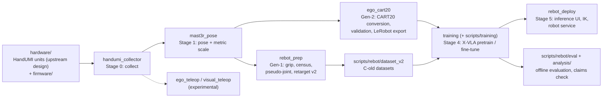
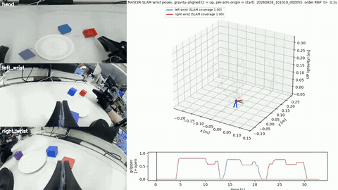

# Egocentric Human Demonstrations for Robot Manipulation

Bimanual human demonstrations recorded with a hand-worn UMI-style gripper (HandUMI), converted into training data for a
reBot B601 dual-arm robot and used to pretrain X-VLA, with every reported number re-checkable from this repository.

Part of **[egocentric](https://github.com/physical-ai-vla/egocentric)** — the entry point to all egocentric-demonstration projects.

[](.github/workflows/ci.yml)
[](LICENSE)

**Technical report:** [`report/report_en.pdf`](report/report_en.pdf) ([한국어](report/report_ko.pdf)) ·
**Claims check:** `python analysis/verify_claims.py` → `736 claims checked, 0 failed.` ([how](#results-and-how-to-verify)) ·
**Hardware:** HandUMI is **BrikHMP18's open-source design** ([murobotics-ai/handumi-hw](https://github.com/murobotics-ai/handumi-hw)), **not ours**
([details](#hardware-source-handumi-is-not-our-design))


## Overview

Research code, calibration, processing records and a small data sample from one experiment. We collected bimanual
human demonstrations with a hand-worn UMI-style gripper ([HandUMI](https://github.com/murobotics-ai/handumi-hw), not our
design; see [Hardware source](#hardware-source-handumi-is-not-our-design)), converted them into pseudo-joint trajectories
for a reBot B601 dual-arm robot, and used them to pretrain X-VLA. Version 3 (October 2026) replaces the joint-space
retargeting with a Cartesian conversion that matches the robot's own action contract, and tests what transfers to the
robot ([Update v3](#update-v3-cartesian-ego-pretraining-and-transfer)). Version 4 (7 October 2026) adds a 30-episode
low-data ablation and splits the write-up into two reports, each in English and Korean
([Update v4](#update-v4-two-reports-r30-ablation-and-single-arm-approach)). Version 5 (12 October 2026) merges everything
into **one technical report**: [`report/report_en.pdf`](report/report_en.pdf) ([한국어](report/report_ko.pdf)), 15 pages
covering hardware, every pipeline stage, all results and their limits, with no result changed. Earlier states are tagged
`report-v2-2026-09-30` and `report-v3-2026-10-04`.

- **Data path.** 349 recorded bimanual three-cube stacking episodes (6 stacking orders) go through sync, pose (MASt3R-SLAM +
  per-episode IMU visual–inertial scale), gripper and gate filtering and are turned into robot training data: first as
  pseudo-joint trajectories (Gen-1), then, from version 3, directly in the robot's relative-Cartesian action contract (Gen-2).
- **Offline result (Gen-1).** On 26 held-out episodes the 300k ego-pretrained model has a median TCP error of 1.5 / 5.7 mm
  (k=1 / k=30); the stacking instruction changes predictions but does not make them more accurate.
- **Ego pretrain → robot fine-tuning.** After 250k steps of R150 fine-tuning, the ego-initialised model beats scratch on most
  offline metrics (geo −10.0 %), but all 10 evaluation episodes are inside both fine-tuning sets, so this measures fit, not generalisation.
- **Transfer diagnostics (Gen-2).** Ego initialisation lowers early robot fine-tuning loss, and the advantage disappears
  with more steps; the ego-only policy does not transfer to robot camera images, and the gap is visual.
- **No closed-loop success rate** is reported anywhere in this repository (see [What this repository does not show](#what-this-repository-does-not-show)).

**Status: offline evaluation and training diagnostics.** Version-3 checkpoints were executed on the robot, and an
ego-initialized model fine-tuned on 312 robot episodes completed full three-cube stacks in closed loop (operator
observation; trials not counted, no video). This repository reports **no closed-loop success rate**.

## System at a glance



## Components

| Component | Path | Stage | Status | Description |
|---|---|---|---|---|
| hardware | [`hardware/`](hardware/), [`firmware/`](firmware/) | device | current | HandUMI print package from upstream (not our design), our 3 modified parts, wrist-IMU firmware (Teensy 4.1 / XIAO nRF52840) |
| handumi_collector | [`src/handumi_collector/`](src/handumi_collector/) | 0 collect | current | Raw recorder: head C922 + wrist fisheye/IMU/jaw → mp4 + `sensors.mcap`; calibration and QA tools; `robot_like_v1` protocol |
| configs | [`configs/`](configs/) | all | current | Versioned calibrations, collector profiles, teleop configs; `dataset_calibration/` = the calibrations the reported dataset uses |
| mast3r_pose | [`src/mast3r_pose/`](src/mast3r_pose/) | 1 pose | current | Per-frame MASt3R-SLAM wrist pose and IMU-VI metric scale |
| rebot_prep | [`src/rebot_prep/`](src/rebot_prep/) | 2–3 dataset, retarget | superseded (by ego_cart20) | Gen-1: gripper width, census and gates, pseudo-joint continuity IK, retarget v2 with frozen contracts |
| ego_cart20 | [`src/ego_cart20/`](src/ego_cart20/) | 2 dataset | current | Gen-2: CART20 / RELCART20 conversion, jump filter, validators, LeRobot exporters, cube-PnP scale, right-only (HRA), robotize, UMI fusion |
| training | [`src/training/`](src/training/), [`scripts/training/`](scripts/training/) | 4 train | current | REL-only X-VLA plugin, UMI76/RELCART20 derivation and gates, reBot FK; node launchers and archivers; Gen-1 trainer in `scripts/training/c8old/` (superseded) |
| rebot_deploy | [`src/rebot_deploy/`](src/rebot_deploy/), [`scripts/rebot/loaders/`](scripts/rebot/loaders/) | 5 deploy | current | Inference core, robot web UI (PLAN / RTC / trial logger), Pink IK, MIT robot service, checkpoint loaders |
| evaluation | [`scripts/rebot/eval/`](scripts/rebot/eval/), [`analysis/`](analysis/) | 5 evaluate | current | Offline checkpoint evaluation and audits; `analysis/verify_claims.py` recomputes every reported number |
| hra | [`scripts/rebot/hra/`](scripts/rebot/hra/) | 1–5 (single arm) | current (sub-study) | Separate sub-study: right-arm approach to a cube (HRA_red, HRA_A100) — Part II of the report |
| ego_teleop, visual_teleop | [`src/ego_teleop/`](src/ego_teleop/), [`src/visual_teleop/`](src/visual_teleop/) | teleop | experimental | Wearable VIO teleop and visual RGB-D teleop research; not deployed |
| ego_collector | [`src/ego_collector/`](src/ego_collector/) | 0 collect | superseded (by handumi_collector) | V0 AprilTag-glove collector; its `camera` layer is still imported |
| laundry, parity | [`scripts/rebot/laundry/`](scripts/rebot/laundry/), [`scripts/rebot/parity/`](scripts/rebot/parity/) | 1–3 | cross-project | Belong to the laundry (T-shirt flattening) project: UMIalign pose + visual gripper; UMI TCP calibration and UMI → reBot replay parity |
| report, results | [`report/`](report/), [`results/`](results/), [`docs/`](docs/) | — | current | Technical report (EN/KO, PDF + LaTeX), result records, guides and provenance |
| upstream | [`upstream/`](upstream/) | — | third-party | Licences, NOTICE and our patch on top of HandUMI software |

Each component has a README with its inputs/outputs, entry points and layout. The old → new path table for the
2026-11-01 restructure is in [`docs/provenance/README.md`](docs/provenance/README.md).

## Installation

```bash
git clone https://github.com/physical-ai-vla/egocentric-cube-stacking.git
cd egocentric-cube-stacking
pip install -e ".[collector,experimental,dev]"     # or: uv pip install -e ".[collector,experimental,dev]"
pytest tests/cart20 tests/experimental/teleop tests/experimental/v0 -q
python analysis/verify_claims.py                   # needs only pyyaml
```

The root `pyproject.toml` (src layout) declares the packages under `src/`; extras: `collector` (devices, mcap, PySide6),
`experimental` (mediapipe), `apriltag`, `viz`, `aero`, `dev`. Training and MASt3R-SLAM run in separate environments on GPU
nodes (LeRobot with X-VLA, MASt3R-SLAM checkout); see [Where each part ran](#running-it).

## Pipeline

The stages below are the ones that produced the reported data. Commands are the existing entry points; most stage
scripts read and write the data roots of the machine they ran on (`~/c8`, `~/umi_bridge`, node paths).

| Stage | What | Entry points |
|---|---|---|
| 0 Collect | record HandUMI episodes (head C922 + wrist units) | `python -m handumi_collector.collect --hardware handumi_v1 --dataset Hpilot` (`--protocol robot_like_v1` for HRL80) |
| 1 Pose | export → per-frame MASt3R-SLAM → metric scale | `scripts/rebot/c8/c8_export.sh` (`scripts/umi_export_orbslam.py`), `scripts/rebot/mast3r/c8_run_5080.sh <side list> <out dir>` (`src/mast3r_pose/run_perframe.py`), scale `src/mast3r_pose/cp6_scale.py` (IMU-VI) or `src/ego_cart20/cube_pnp.py` (cube PnP) |
| 2 Dataset, Gen-2 | raw episodes → CART20 rows → validation → LeRobot | `python src/ego_cart20/sources/handumi_export.py --out <raw>`, `src/ego_cart20/scripts/convert_dataset.py <raw> <out>`, `validate_dataset.py <out>`, `export_lerobot.py <out> <lerobot>` |
| 2 Dataset, Gen-1 | gripper, census, Phase-3 segments, C-old builders | `src/rebot_prep/grip/c8_grip.py`, `src/rebot_prep/census/c8_census_pre.py`, `c8_phase3.py`, `scripts/rebot/dataset_v2/` builders and validators |
| 3 Retarget (Gen-1) | pseudo-joint continuity IK; multi-seed retarget v2 | `src/rebot_prep/pseudo_joint/pseudo_joint_pipeline.py`, `src/rebot_prep/retarget/v2k_retarget.py`, chains in `src/rebot_prep/retarget/chains/` |
| 4 Train | X-VLA pretrain on ego data, fine-tune on robot data | Gen-2: `scripts/training/ego_cart20/submit_ego_cart20v2.sh <gpu>`, `scripts/training/node4090/*.sh`, `scripts/training/node5090/*.sh` (`src/training/relonly/`); Gen-1: `scripts/training/c8old/c8old_chain.sh` |
| 5 Deploy / evaluate | serve a checkpoint on the robot; offline evaluation | `scripts/rebot/loaders/load_relonly_run_ckpt_to_ui.sh <step> [port]` (starts `src/rebot_deploy/mac_v4_smoke_ui.py`), `src/rebot_deploy/robot_service/robot_service_mit.py`; offline `scripts/rebot/eval/c8old/c8old_mac_eval.py`, `scripts/rebot/eval/rel16_audit/` |

Component guides with the full command lines: [`docs/collector/`](docs/collector/README.md),
[`docs/cart20/`](docs/cart20/README.md), [`docs/training/`](docs/training/README.md), [`docs/deploy/`](docs/deploy/README.md),
[`docs/hra/`](docs/hra/README.md).

## Codebase guide

**The split.** Importable code lives in `src/` as one package per concern (`handumi_collector`, `mast3r_pose`,
`rebot_prep`, `ego_cart20`, `training`, `rebot_deploy`, plus the experimental `ego_teleop`, `visual_teleop` and the
superseded `ego_collector`). Command-line tools and machine-specific run bundles live in `scripts/`; configs and
calibrations in `configs/`; result records in `results/`; the claims checker and post-hoc analyses in `analysis/`.
Scripts that ran on GPU nodes or against data roots keep their original sibling imports and absolute data paths.

**The interfaces.**

| interface | definition | where it is defined |
|---|---|---|
| raw episode | per-stream mp4 + `sensors.mcap` (IMU, gripper, per-frame camera metadata, sync events), `episode_meta.json`, `events.json` | [`docs/collector/README.md`](docs/collector/README.md), [Sample data](#sample-data) |
| Gen-2 action (CART20) | 16 future poses `inv(T(t)) @ T(t + k·UMI_DT)`, k = 1..16, `UMI_DT` = 3/59.94 s (50.05 ms), so 0.80 s; per arm `[xyz, rot6d, g]`, LEFT first, grippers at dims 9 and 19; model action `[16, 32]` = CART20 + 12 exact zeros (AUX12) | [`src/ego_cart20/config.py`](src/ego_cart20/config.py), [`docs/cart20/README.md`](docs/cart20/README.md) |
| Gen-2 state (RELCART20) | each arm's pose relative to its task start, `[L pose9, R pose9, gL, gR]` (20-D); rows stored at 15 Hz | same |
| rotation | rot6d = first two **rows** of R (UMI `mat_to_rot6d`); quaternions are wxyz | same |
| gripper (ego labels) | continuous aperture, 0 = closed, 1 = open (aperture / 80 mm); source = the HandUMI **Feetech jaw servo encoder** for the cube-stacking data (`src/rebot_prep/grip/`), wrist video only while the servos were off (10-13 → 10-28), servo encoder again from 10-29 | same |
| gripper (reBot raw) | raw 0 = CLOSED, −270 = OPEN; commands 0..45 with raw = −6·cmd | [`docs/OPERATIONS_NOTES.md`](docs/OPERATIONS_NOTES.md) |
| Gen-1 action | Δq_pseudo chunk `q[t+5+i] − q[t]`, i = 0..29 (LEAD 5, 30 steps), on 65-frame segments | [`scripts/training/c8old/humanik_delta.py`](scripts/training/c8old/humanik_delta.py) |
| frames | dataset TCP and the `eef_kin` FK TCP differ by R_y(90°); the IK TCP is `gripper_link` + 0.07 m along x | [`docs/OPERATIONS_NOTES.md`](docs/OPERATIONS_NOTES.md) |
| X-VLA domain id | only base slots 10–17 were pretrained; our embodiment uses slot 20 | [`docs/OPERATIONS_NOTES.md`](docs/OPERATIONS_NOTES.md) |
| data contracts (node side) | UMI76 and RELCART20 contracts | [`src/training/umi76/UMI76_CONTRACT.md`](src/training/umi76/UMI76_CONTRACT.md), [`RELCART20_CONTRACT.md`](src/training/umi76/RELCART20_CONTRACT.md), [`docs/training/UMI_XVLA_CONTRACT.md`](docs/training/UMI_XVLA_CONTRACT.md) |

## Results and how to verify

`analysis/verify_claims.py` recomputes every number in the report and in this README from files in this repository and
fails on any mismatch:

```bash
python analysis/verify_claims.py      # prints "736 claims checked, 0 failed."; exits 1 on any mismatch
python analysis/verify_claims.py --md analysis/out/claim_audit.md   # also writes the per-claim table
```

The per-claim table (section, claim, report value, recomputed value, evidence file, status) is
[`analysis/out/claim_audit.md`](analysis/out/claim_audit.md). Other reproduction commands:

```bash
python3 analysis/verify_claims.py --md analysis/out/claim_audit.md   # needs pyyaml; exits 1 on any mismatch
python3 analysis/paired_bootstrap_r150.py                            # R150 250k episode-level bootstrap
python3 analysis/v3/ego_init_loss_compare.py                         # v3 matched initialization comparison
python3 analysis/v4_r30_ablation.py && python3 analysis/v4_hra_summary.py   # v4 numbers + Figs. 8-9 (need matplotlib)
python3 report/figures/make_figures.py && python3 report/figures/make_figures_v3.py
cd report && for f in part1_stacking_en part1_stacking_ko part2_approach_en part2_approach_ko methods_en methods_ko; do tectonic $f.tex; done   # full versions: cd archive
# the Korean reports use xeCJK with the macOS fonts AppleMyungjo / Apple SD Gothic Neo
```

### Reports

| Report | English | 한국어 | Full-length version |
|---|---|---|---|
| **Technical report (v5, one document, 15 pp)** | [`report/report_en.pdf`](report/report_en.pdf) | [`report/report_ko.pdf`](report/report_ko.pdf) | (is the full report) |
| Part I: three-cube stacking (bimanual), 4 pp | [`report/part1_stacking_en.pdf`](report/part1_stacking_en.pdf) | [`report/part1_stacking_ko.pdf`](report/part1_stacking_ko.pdf) | `report/archive/part1_stacking_{en,ko}_full.pdf` (11 pp, v4.1) |
| Part II: single-arm approach to a cube, 2 pp | [`report/part2_approach_en.pdf`](report/part2_approach_en.pdf) | [`report/part2_approach_ko.pdf`](report/part2_approach_ko.pdf) | `report/archive/part2_approach_{en,ko}_full.pdf` (5 pp) |
| Methods and pipeline (how every stage works), 6 pp | [`report/methods_en.pdf`](report/methods_en.pdf) | [`report/methods_ko.pdf`](report/methods_ko.pdf) | — |

The v5 technical report is the main document. The earlier split documents remain: short versions in `report/`, full-length
versions in `report/archive/`. LaTeX
sources sit next to the PDFs; figures are rebuilt by `report/figures/make_figures*.py`, `analysis/v4_r30_ablation.py` and
`analysis/v4_hra_summary.py`. The v3 single report is also in `report/archive/`. `analysis/verify_claims.py` also checks that every value required in the full-length reports appears in the v5 report.
All reports now cite the upstream HandUMI hardware repository.
The Part I full version 4.1 (2026-10-12) adds Sec. III, *HandUMI hardware*: the upstream HandUMI project (murobotics-ai/handumi-hw by BrikHMP18,
formerly robonet-ai; we built `e58de33` and forked handumi-sw at `33cc437`, the fork not used for the reported data), print and electronics, our deviations (no VR tracking, added Teensy 4.1 + ICM-42688-P wrist IMU, fixed-focus head
C922), our three modified parts (Fig. 2, `report/figures/make_fig10_handumi_mods.py`) and device-identity pitfalls. The hardware
files are in `hardware/` and in our build copy [`physical-ai-vla/umihand`](https://github.com/physical-ai-vla/umihand); the design itself is
upstream [murobotics-ai/handumi-hw](https://github.com/murobotics-ai/handumi-hw).

### Demonstration videos


Head-camera view of three recorded human demonstrations (2x speed). Left to right: RBP (train), PRB (train),
BPR (held-out validation episode). Full-length videos (640x480, 30 fps, 23 s, no audio):

| Episode | Order (bottom → top) | Split | Video |
|---|---|---|---|
| `20260917_150545_000001` | red, blue, purple | train | [head.mp4](sample_data/20260917_150545_000001/head.mp4) |
| `20260917_150545_000005` | purple, red, blue | train | [head.mp4](sample_data/20260917_150545_000005/head.mp4) |
| `20260917_150545_000010` | blue, purple, red | held-out | [head.mp4](sample_data/20260917_150545_000010/head.mp4) |

**MASt3R-SLAM wrist trajectories** (v3): head + both wrist cameras, gravity-aligned 3D wrist trajectory and gripper
trace. Details in [MASt3R-SLAM trajectory videos](#mast3r-slam-trajectory-videos).

| Video | Take | Metric scale |
|---|---|---|
| [hrl80_000035_wrist.mp4](docs/media/mast3r_trajectories/hrl80_000035_wrist.mp4) | HRL80 bimanual stacking, PRB, 33 s | IMU-VI |
| [hrl80_000055_wrist.mp4](docs/media/mast3r_trajectories/hrl80_000055_wrist.mp4) | HRL80 bimanual stacking, RBP, 33 s | IMU-VI |
| [hrl80_000060_wrist.mp4](docs/media/mast3r_trajectories/hrl80_000060_wrist.mp4) | HRL80 bimanual stacking, PBR, 33 s | IMU-VI |

These are human demonstrations recorded with the hand-worn rig, not robot rollouts. Wrist-camera videos are not
published (see [Sample data](#sample-data)).

### Dataset

- **Task:** stacking three cubes (red, blue, purple) on a plate, in 6 stacking orders (RBP, RPB, BRP, BPR, PRB, PBR).
  The instruction text is `Stack the {bottom} cube on the bottom, {middle} cube in the middle, and {top} cube on the top, on the plate.`
- **Rig:** each hand wears a HandUMI unit with a wrist fisheye camera (1080p, 30 fps), a Teensy IMU (200 Hz) and a
  Feetech jaw encoder. A fixed C922 head camera (640x480, 30 fps) looks down at the table.
- **Processing funnel:**
  - 349 recorded episodes
  - 284 pass sync (left wrist is the master clock; the right wrist and head must be within 20 ms)
  - 259 source episodes remain after pose, gripper and gate filtering
  - 561 bimanual segments of 65 frames each
- **Pose:** MASt3R-SLAM gives the RGB-only wrist-camera pose. Metric scale comes from a per-episode IMU visual-inertial
  fit (`cp6_scale.imu_vi`). On a separate 14-episode ArUco benchmark (10 tracks held out) the scale error is
  4.6 / 17.0 % (p50 / p90) and the 16-step relative position error p90 is 11.3 mm (`results/pose_benchmark/`). The camera-to-TCP transform is `handumi_camera_tcp_v2`.
- **Retargeting:** trajectories are anchored at the robot start pose and retargeted to reBot B601 pseudo-joints with
  continuity IK. Segments then pass workspace, metric and IK gates (an inter-arm clearance check is used only in
  retargeting v2). Sessions with inconsistent
  IMU and camera rotation are quarantined (`results/c8_quarantine.json`).
- **Split:** by source episode, never by segment. `numpy.random.default_rng(0)` gives 233 train episodes (504 segments)
  and 26 held-out episodes (57 segments). See `results/split_index.json`.
- **Model:** X-VLA (879M parameters), initialised from `lerobot/xvla-base`, pretrained for 300k steps on the ego set. Loss terms:
  - Main target: a Δq_pseudo action chunk, `q[t+5+i] - q[t]` for i = 0..29 (LEAD 5, 30 steps). It is defined in `scripts/training/c8old/humanik_delta.py`.
  - EEF auxiliary loss on relative TCP xyz (`XVLA_EE_AUX`).
  - FK-consistency loss.
- **Evaluation:** offline, on the 26 held-out episodes. Metrics are joint MAE against a zero-action baseline, FK
  position error, direction cosine and a collapse ratio. The checkpoint selection rule was registered before any
  results (`geo_score`); a second, motion-gated selector was added post hoc and is labelled as such
  (`results/selection.json`).

The held-out set is a random 10% of source episodes. It is not balanced by order or by session, and the cube layouts
were not systematically randomised. None of the results here are claims about generalisation.

### Sample data

`sample_data/<session>_<episode>/` holds three episodes from session `Hpilot_20260917_150545`:

| id | order | split |
|---|---|---|
| `20260917_150545_000010` | BPR | held-out (val) |
| `20260917_150545_000001` | RBP | train |
| `20260917_150545_000005` | PRB | train |

Each episode directory contains:

- `episode_meta.json`, `events.json`
- `sensors.mcap`: IMU, gripper, per-frame camera metadata and sync events
- `head.mp4`: head camera, re-muxed video-only
- `derived/pose_mast3r_filtered/`: per-side camera/TCP pose parquet files, canonical table and pose QA
- `segments_<id>.npz`: the processed 65-frame segments. Keys are `starts, st, ac, tcp_tgt, vfL, vfR, vfH, epd, instr, val`. `epd` is the episode path relative to the raw dataset root (`Hpilot/<session>/<episode>`).
- `right_wrist_frame.jpg`: one 640 px frame from the right wrist camera. It was checked by eye to show only the tabletop, cubes, plate and HandUMI hardware.

The sample episodes ship the head video only; wrist fisheye views of three HRL80 takes are shown in the
[MASt3R-SLAM trajectory videos](#mast3r-slam-trajectory-videos).

### Key results (offline, 26 held-out episodes, final 300k checkpoint)

| | all arm-samples (798) | moving, TCP ≥ 20 mm by k=30 (187) |
|---|---|---|
| median TCP error, k=1 / k=30 | 1.5 / 5.7 mm | 11.2 / 39.9 mm |
| joint MAE k=30 (zero-motion predictor) | 0.97° (0.51°) | 6.59° (8.68°) |
| TCP direction cosine, k=30 | 0.81 | 0.90 |

- Aggregate errors are dominated by static phases; on static samples the policy predicts spurious motion.
- Prompt swap: the 6 order instructions move the k=30 prediction by 4.8 mm (≈8 % of the 62 mm predicted displacement),
  and the true instruction is no closer to the recorded motion than a wrong one (mean rank 3.55 of 6, chance 3.5).
  The instruction measurably changes predictions but does not make them more accurate.

### Update v2: multi-seed retargeting, robot-like collection, combined dataset

The first release used a single-anchor retarget ("v1"). Every segment started from one robot posture, so v1 lost
most segments at the workspace gate and collapsed the pseudo-joint starts onto one posture. v2 changes the retargeting
and adds a second, robot-like collection. Nothing in the first-release dataset was modified.

**Status: offline only.** The v2 ego pretrain on the 996-segment dataset was stopped by us at 211.7k of 300k planned
steps; the 100k (primary) and 200k checkpoints are kept (`results/finetune/C_OLD_TR_HANDOFF.json`). No robot
fine-tuning result from them is reported. The fine-tuning comparison below uses the **v1** ego pretrain.

#### Retarget v2 under an R30-only contract

Every quantity taken from real robot data (seed-bank bounds, workspace gate, manifold penalty, TR window library) comes
from 30 robot episodes (R30) only. R30 is part of every later fine-tuning subset. Evaluation uses the remaining 120
robot episodes (held-out R120). Results on the old 259 source episodes (1,229 candidate segments):

| method | usable | posture NN to held-out R120, p50 / p90 (rad) | W1 \|dq\| vs held-out |
|---|---|---|---|
| v1 single anchor | 36.5 % | 1.494 / 1.551 | 0.00197 |
| v2-K kinematic multi-seed | 66.6 % | 1.206 / 1.599 | 0.00275 |
| v2-Kr + manifold penalty | 67.0 % | 0.441 / 0.738 | 0.0031 |
| v2-TR R30 window retrieval | 56.1 % | 0.272 / 0.454 | 0.00208 |

- TR is the primary method. It gives the closest postures but fails more segments; almost all of its failures are
  `no_workspace_window`.
- On the 686 segments that both TR and Kr solve, TR's velocity W1 advantage is small (0.00207 vs 0.00226). Most of the
  dynamics gap in the table comes from which segments each method keeps. The posture gain holds on the matched set.
- The hybrid master (TR if feasible, else Kr) was frozen before HRL80 was retargeted. The primary pretrain set uses TR
  segments only; hybrid-all is kept as an ablation.

Code: `src/rebot_prep/retarget/`. Frozen contracts: `src/rebot_prep/retarget/contracts/`. Results: `results/retarget_v2/`.

#### Robot-like collection (protocol `robot_like_v1`, dataset HRL80)

The protocol runs inside the existing collector (`--protocol robot_like_v1`). It uses 30 s AUTO episodes and a live
panel of wrist rotation speed and acceleration against reBot R150 p95 levels, and tracks grasp stages. After each
session, an offline MASt3R → IK robot-feasibility check runs. Without the flag, the collector behaves exactly as in the
first release.

- HRL80 = 60 episodes, 10 per order, in one session on 2026-09-28 with one operator. The target was 14 per order.
- Retargeted with the same frozen pipeline: TR 58.9 % (old259: 56.1 %), Kr fallback 15.5 % (11.2 %), none 25.5 %
  (32.7 %); hybrid usable 74.5 % (67.3 %).
- HRL80 wrist rotation speed was lower than old259's (median over-p95 fraction 0.067 vs 0.144), but per-episode
  TR feasibility did not change (0.59 vs 0.592). The live metric does not track feasibility: Spearman ρ −0.10 old259,
  −0.17 HRL80, −0.11 pooled. The pre-registered reading that fits is "live up, offline flat". The workspace remains the
  main failure. The two groups differ in session and scene as well as protocol, so any difference is only associated
  with the protocol, not shown to be caused by it. We read this as a negative, diagnostic result: collection style is
  not what limits retarget yield.

Code: `src/handumi_collector/robotlike/`, `scripts/robotlike_*`, `configs/handumi/robot_like_v1.yaml`,
`docs/collector/ROBOT_LIKE_PROTOCOL.md`. Results: `results/hrl80/`.

#### C-old v2 dataset (final, frozen)

- 996 TR segments of 65 frames each: old 689 plus HRL80 307.
- Split: train 896 / val 100, taken by source episode (284 / 32).
- Chunk starts: 27,776 train / 3,100 val.
- Val = the first release's 26 held-out episodes + HRL80 episodes 49–54, one round of all six orders. Report these two
  val groups separately.
- The old segments are appended unchanged. Rows, task strings and every decoded video frame are verified identical to
  the frozen old259 snapshot (invariants I0–I5).

Builders and validators: `scripts/rebot/dataset_v2/`. Metadata and manifests (no video or parquet data): `results/dataset_v2/`.

#### Ego pretrain → robot fine-tuning (v1 ego pretrain)

At 250k steps of R150 fine-tuning, the model initialised from the v1 ego pretrain beats scratch (`lerobot/xvla-base`,
same recipe) by a small margin on most metrics:

| metric | geo | motion geo | k30 FK p50 | motion k30 MAE |
|---|---|---|---|---|
| C-old vs scratch | −10.0 % | −7.2 % | −4.1 % | −6.8 % |

- Episode-level paired bootstrap (10k draws, `analysis/paired_bootstrap_r150.py`): geo 95 % CI −14.7 to −5.6 %,
  motion geo −13.4 to −1.8 %, motion k30 MAE −12.7 to +0.5 %; 8 of 10 episodes favour the ego init.
- Episodes 66/77, motion geo: C-old is worse (+4.2 %).
- **All 10 evaluation episodes are in the R150 fine-tuning data of both arms.** This comparison measures fit to seen
  episodes, not generalisation.
- R90 was stopped early and compared at only 2 matched steps (10k, 20k). Signs are mixed: C-old is better on all-sample
  geo (−33 %, −11 %) and worse on motion geo (+2 %, +13 %). There is no conclusion. R60 (scratch arm only) and R30
  (≤ 20k steps) were also stopped; `results/finetune/RUN_STATUS.json` lists every run's final state. None is running.

Records: `results/finetune/`. The v2 pretrain launch record is `results/finetune/FINAL_TR300K_LAUNCH.json`.


### Update v3: Cartesian ego pretraining and transfer

Retargeting to robot joints removed a third to a half of the human motion and produced a joint-space target that our robot
policies are not trained in. Version 3 converts whole human episodes directly into the robot's own relative-Cartesian
action contract, then tests what transfers. Report sections X–XIII. Run status for every v3 run:
`results/v3/RUN_STATUS_v3.json`.

**Status:** training diagnostics, plus one unlogged closed-loop observation. Checkpoints were executed on the robot
(`results/v3/hardware_cycles_by_ckpt.csv`: 71 checkpoints, 49,431 control cycles); the log records IK tracking, not task
outcome. The operator observed complete three-cube stacks with the ego-initialized R312c model (B300, checkpoints
75k–205k). Trials were not counted and there is no video, so this is a demonstration, not a success rate, and no scratch
model on the same data was tested the same way.

#### Data contract and dataset (`src/ego_cart20/`)

- Rows at 15 Hz. Action = 16 future poses `inv(T(t)) @ T(t + k·50.05 ms)`, k = 1..16 (0.80 s), interpolated on the raw
  30 Hz track. Per arm xyz + 6-D rotation + gripper = CART20; the model's 32-D action is padded with 12 exact zeros.
- State = each arm's pose relative to its task start + both grippers (same layout as the robot data). Gripper =
  continuous aperture / 80 mm (max observed 0.847).
- No workspace or IK filtering. 330 episodes (273 original + 57 HRL80; 3 refused for invalid IMU scale).
  111,533 rows at 15 Hz, of which 57,283 (51.4 %) are trainable.
- Frozen split: train 298 episodes / 51,612 rows, val 32 / 5,671.
- **Silent pose jumps.** 57 % of apparent > 30 mm state jumps (1,482 / 2,598) were time gaps between exported rows. The rest
  are MASt3R-SLAM translation jumps without a tracking-lost flag (55 raw steps > 3 m/s in 24 training episodes). The v2b filter
  acts on 44 events in 42 episodes → **train 297 / 48,411 rows (−6.20 %)**, val unchanged; max adjacent step 422.5 → 90.5 mm.
- Contract tests: `tests/cart20/test_contract.py` (11 tests, all pass).

Evidence: `results/v3/ego_cart20/`, `results/v3/state_jump/`.

#### MASt3R-SLAM trajectory videos

Bimanual HRL80 takes. Left: head camera and both wrist fisheye cameras. Right: gravity-aligned MASt3R-SLAM wrist
trajectories (z up, each arm's origin at its start, current tool axes drawn) with IMU visual–inertial metric scale, and
both grippers below (1 = open). Click a preview for the MP4 (960×540).

<table>
<tr><td align="center" width="50%"><a href="docs/media/mast3r_trajectories/hrl80_000035_wrist.mp4"></a><br><sub>HRL80 stacking, order PRB (33 s, shown 3×)</sub></td><td align="center" width="50%"><a href="docs/media/mast3r_trajectories/hrl80_000055_wrist.mp4"></a><br><sub>HRL80 stacking, order RBP (33 s, shown 3×)</sub></td></tr>
<tr><td align="center" width="50%"><a href="docs/media/mast3r_trajectories/hrl80_000060_wrist.mp4"></a><br><sub>HRL80 stacking, order PBR (33 s, shown 3×)</sub></td><td></td></tr>
</table>

Renderer: `analysis/v3/viz_mast3r_episode.py`.


#### Ego vs robot, and the soft-prompt audit

- Robot IK reaches 99.7 / 99.5 % of ego positions (L / R) and 72.3 / 74.6 % of full ego poses. The deployed IK
  (one wrist joint locked) reproduces only 45.2 / 52.2 % of the robot's **own** poses.
- Wrist-image sharpness (Laplacian variance, p50): ego 1,854 / 1,487 vs robot 59 / 64
  (`results/v3/robotized/wrist_sharpness_val.json`).
- **X-VLA soft-prompt slots:** only slots 10–17 of `lerobot/xvla-base` were ever trained. Ids 0 and 6, both used by our
  earlier runs, were untrained. Initial loss on R312c: slot 0 1.11, 6 1.12, 15 1.61, 10 2.35, 16 2.65, 17 4.07, 11 22.80.
  All v3 runs use unused slot 20. Evidence: `results/v3/domain_slots/`.

#### Transfer diagnostics

| test | result | evidence |
|---|---|---|
| Ego-only 40k on 120 robot frames, k8 direction cosine (L / R) | −0.05 / −0.03 (robot-trained 40k: +0.81 / +0.77, in-training frames) | `results/v3/diagnostics/direction_cosine_ego40k_vs_robot40k.txt` |
| Same, best of 12 L↔R swap × axis-flip variants | max +0.16 (not a convention error) | `…/direction_cosine_flip_swap.txt` |
| Image/state swap: ego images + any state | 0.69–0.90 | `…/image_state_ablation_ego40k.txt` |
| Image/state swap: robot images + any state | −0.25 to +0.49 → the gap is visual | same |
| Ego init (50k) vs scratch, R312c fine-tuning loss, identical data/schedule/seed | step 200: 0.244 vs 0.945; B/A 0.49 (0–5k), 0.875 (5–20k), 0.95 (20–40k), 0.984 (55–60k, tie) | `analysis/out/v3_ego_init_loss.json`, `results/v3/loss_curves/` |

- The diagnostic outputs were captured from the session log (the runs wrote no file); each text file says so and names the
  script in `analysis/v3/`.
- The loss comparison is training loss with one seed per arm. The two finished 300k runs used **different robot datasets**
  (R312c vs R384), so they are not a transfer comparison.
- **Robotized wrist** (`src/ego_cart20/scripts/export_lerobot_robotized.py`): fisheye → virtual pinhole (hfov 62–70°,
  jaws low), blur, JPEG. ROBOT100 (all frames) sharpness 181 / 132, still 2–3× the robot. The MIX70 pretrain was stopped at 5k.
  Co-training (4 ego + 4 robot per batch, `src/training/relonly/train_cotrain.py`) was stopped at 88.6k without evaluation. The
  The ROBOT100 300k pretrain finished on 10-05 (loss 0.007); its 100k and 300k checkpoints initialize the R30 ablation (v4).

#### HRA_red: right-hand approach with cube-based scale

- 200 right-hand takes of "approach the red cube". The IMU visual–inertial scale is unobservable on these slow motions: median
  0.012, ≤ 0 in 95 of 200 episodes.
- **Cube PnP scale** (`src/ego_cart20/cube_pnp.py`, edge 3.8 cm). Validated on HRL80 takes, where the IMU is reliable:
  37 / 57 valid, PnP/IMU median 1.062 (p16–p84 0.959–1.274).
- Funnel 200 → 181 (scale gates) → 166 (physical sanity). Train 151 episodes / 20,319 rows; val 15 / 2,011.
- Loss-masked training (left arm and gripper masked; 9 / 20 dims supervised; `src/training/relonly/rel16_relonly_lossmask.py`).
  The 300k run finished on 10-05 (training loss 0.002).
- Held-out loss at 15k: 0.150 vs train-subset 0.066, rising to 0.299 at 105k: the model overfits 151 episodes.
- Robot runs (8,397 cycles on 10-04) logged no outcome. Everything after v3 on this task is in Part II (v4).

Evidence: `results/v3/hra_red/`.


### Update v4: two reports, R30 ablation and single-arm approach

#### Part I: low-data ablation on 30 robot episodes

Three otherwise identical fine-tuning runs on **R30** (R312c episodes 150–179, 17,600 frames), 600k cosine schedule, from
the base model (scratch) and from the ROBOT100 ego pretrain at 100k and 300k steps. Training loss only, one seed per arm;
the 100k-init and scratch ran on an RTX 4090 (torch 2.6), the 300k-init on an RTX 5090 (torch 2.7.1).

| window | ego-PT 100k init / scratch | ego-PT 300k init / scratch |
|---|---|---|
| 1k–5k | 0.544 | 0.493 |
| 10k–20k | 0.823 | 0.697 |
| 50k–100k | 0.970 | 0.856 |
| 100k–150k | 1.021 | 0.914 |

Both ego initializations start below half the scratch loss; the advantage is gone by ~100k (100k-init) and ~200k
(300k-init). All three runs were stopped (471k / 305k / 310k, 139–214 epochs): every arm memorizes 30 episodes. **No R30
checkpoint has been run on the robot and there is no held-out robot evaluation**, so this is not a transfer result. The
trial logger in the deployment UI exists but has recorded no trial. Evidence: `results/v4/loss_curves/`,
`results/v4/r30_ablation_summary.json`, `results/v4/RUN_STATUS_v4.json`.

#### Part II: single-arm approach (HRA_red → robot camera rendering → HRA_A100)

- **Robot-side calibration:** head C922 (checkerboard, RMS 1.05 px), robot right-wrist hand-eye (13 views, 0.16 px RMS; camera
  169.5 mm behind the TCP, optical axis 33° below TCP x). The IK stack's TCP lies ~82 mm ahead of the physical jaw tip; contact
  now uses the URDF fingertip box.
- **robotcam v2:** wrist frames re-rendered with the measured robot camera (hfov 52°), labels as robot-TCP poses via hand-eye.
- **HRA_A100 protocol:** every take starts with the HandUMI jaw tip held 2 s on a taped cross that the robot jaw tip also
  touched → shared task frame G (3-point line fit, collinearity 0.38 mm; table z −27.1 mm). Scale from cube PnP or the table
  plane at the origin (ratio to PnP 0.999); origin yaw measured per take.
- **Table-aware conversion** (fingertip floor = table + 5 mm): CT5/CT6 keep 86 of 107 takes, clearance p50 12.6 mm, min 7.6 mm.
- **Training:** start- vs origin-anchored state give the same held-out loss (0.124 vs 0.132 at 5k); every run overfits from the
  first checkpoint.
- **Robot:** 192 planned-execution sessions on 10-06/07; on 10-07, 69 of 127 ended on a cube-size stop (a proximity proxy, not
  contact). **No trial outcome was logged; no success rate.**

Evidence: `results/v4/hra/` (validation losses, calibration files, table-aware reports, start poses, plan-session summary).


### Update 2026-10-20: servo-less HandUMI, visual gripper, T-shirt flattening data, UMI→robot calibration

After the v5 report the work moved to T-shirt flattening for the laundry project. Summary in
[`docs/UPDATE_2026-10-20.md`](docs/UPDATE_2026-10-20.md) ([한국어](docs/UPDATE_2026-10-20_ko.md)); the report itself is unchanged.

- **Hardware:** jaw servos removed (10-13) — **reinstalled 10-29** as torque-off jaw encoders (laundry project; see
  [egocentric-garment-manipulation](https://github.com/physical-ai-vla/egocentric-garment-manipulation)); red tape on the jaw tips (later removed); AprilTag rigs (200–202 / 210–212) per unit; XIAO
  nRF52840 wrist IMUs replace the Teensy ([`hardware/README.md`](hardware/README.md)).
- **Gripper open/close from the wrist video:** red-tape tip distance per frame (`jaw_track.py`) → hysteresis binary
  (closed ≤ 200 px / open ≥ 260 px) in `src/ego_cart20/sources/jaw_visual.py`; 16/16 spot checks, corr 0.93 vs the servo.
  Used only while the servos were off; from 10-29 the jaw label is the servo encoder again.
- **UMIalign pose pipeline** ([`scripts/rebot/laundry/`](scripts/rebot/laundry/)): MASt3R restart_v1, Orbbec canonical
  tracker, smoother with corrected camera↔IMU rotation + fixed jaw-tip lever + AprilTag gate (TCP error p50 25–36 cm →
  38–59 mm), 65-episode corrected dataset. The fine-tune on it was stopped at ~11k steps; no result.
- **UMI → robot** ([`scripts/rebot/parity/`](scripts/rebot/parity/), `src/ego_cart20/robotize/`):
  robotization (IK-ok p50 0.79, amplitude ~0.81), UMI TCP calibration by corner touch (1–4 mm static), robot camera
  calibration and replay-parity tools built but **not yet run on the robot**.
- **UMI as teleop device** (`src/visual_teleop/`): DPVO / mono VIO NO-GO, stereo VIO first robot teleop then
  dropped (10-16).

### What this repository does not show

- No closed-loop success rate (three-cube stacking was observed with B300, but trials were not counted or recorded).
- No held-out or closed-loop comparison of ego-initialized vs scratch v3 models; the matched comparisons are training loss
  (312 episodes to 60k; 30 episodes to 300k).
- No success rate for the single-arm approach (Part II): robot sessions logged stop reasons, not outcomes.
- No transfer of the ego-only policy, or of the robotized wrist images, to robot cameras.
- No generalization to unseen cube layouts (layouts were not recorded) or to unseen stacking orders (all six are in training).
- No benefit on disjoint robot test data: the 10 % R150 gain is measured on episodes inside both fine-tuning sets.
- No transfer to other operators or scenes (one operator, one scene).

## Current vs superseded

| current | superseded (kept in the repository) |
|---|---|
| Gen-2 Cartesian CART20 / RELCART20 data (`src/ego_cart20/`, report v3+) | Gen-1 pseudo-joint retargeting (`src/rebot_prep/pseudo_joint/`, `census/c8_phase3.py`) |
| retarget v2-TR + frozen hybrid master (`src/rebot_prep/retarget/`) | v1 single-anchor retarget; v2-K / v2-Kr variants |
| C-old v2 dataset builders (`scripts/rebot/dataset_v2/`) | C-old v1 builder (`scripts/rebot/dataset/`) |
| REL-only X-VLA training (`src/training/relonly/`) | Gen-1 trainer and chain (`scripts/training/c8old/`, `scripts/rebot/eval/c8old/`) |
| `src/handumi_collector/` | V0 AprilTag collector `src/ego_collector/` (camera layer still used) |
| `scripts/rebot/loaders/load_*_ckpt_to_ui.sh` | `scripts/rebot/loaders/legacy/` |
| one technical report `report/report_{en,ko}` (v5) | split reports `report/part*`, `report/methods_*`, `report/archive/` |

`src/ego_teleop/`, `src/visual_teleop/` and `scripts/umi_teleop_eval/` are experimental (not deployed). `scripts/rebot/laundry/`
and `scripts/rebot/parity/` belong to the laundry project and are kept here because they reuse this pipeline.
Item-by-item table: [`docs/provenance/README.md`](docs/provenance/README.md#superseded-items-kept-not-deleted).

Conventions: lengths in the CART20 contract are metres (`*_m` fields in `src/ego_cart20/config.py`); frames, gripper signs and other
pitfalls are collected in [`docs/OPERATIONS_NOTES.md`](docs/OPERATIONS_NOTES.md).

### Repository maps by release (historical)

What each release added, with paths updated to the current layout.

#### v2 additions

| dir | contents |
|---|---|
| `src/rebot_prep/retarget/` | seed bank, v2-K / v2-Kr / v2-TR retarget, held-out comparison, hybrid merge, HRL80 prereg report, chain scripts; `contracts/` = frozen rules, R30 list, splits, prereg, gripper contract, seed banks |
| `scripts/rebot/dataset_v2/` | TR / hybrid / HRL80 LeRobot builders, final append, validators, append-invariant checker, env-driven `write_stage.py` |
| `src/handumi_collector/robotlike/`, `scripts/robotlike_*`, `tests/collector/`, `docs/collector/` | robot-like protocol monitor, offline check and group comparison, tests, protocol doc |
| `results/retarget_v2/`, `results/hrl80/`, `results/dataset_v2/`, `results/finetune/` | comparison JSONs, frozen master manifests, HRL80 census and prereg report, dataset manifests and gates, fine-tuning evals and summaries |
| `docs/NUMBERS_v2.md`, `docs/SOURCES_v2.md`, `docs/FINAL_CLAIMS.md` | every v2 number with its file and key; source mapping; headline claim table with evidence and status |

#### Code added on 2026-10-07

The full working code of the project was added, so the repository is no longer only the audited subset:

| path | contents |
|---|---|
| `src/handumi_collector/`, `firmware/`, `configs/` | latest `handumi_collector` (robot_like_v1, HRA_red, HRA_A100 origin protocol, C922-view tile), firmware, calibration configs; imports `ego_collector.camera` |
| `scripts/rebot/hra/` | single-arm approach pipeline: base-frame linking, robot camera and hand-eye calibration, robotcam v2 rendering, origin-plane scale, origin yaw, G frame, table-aware QP, held-out evaluation |
| `src/rebot_deploy/`, `scripts/rebot/loaders/` | inference core, robot UI (PLAN/RTC/cube-size stop/trial logger), Pink IK, checkpoint loaders, MIT robot service |
| `hardware/` | HandUMI print package (3MF/STL) from upstream [murobotics-ai/handumi-hw](https://github.com/murobotics-ai/handumi-hw) (not our design), our modified parts (`mods/`) and build notes; our build copy is [physical-ai-vla/umihand](https://github.com/physical-ai-vla/umihand) |
| `src/ego_teleop/`, `src/ego_collector/`, `scripts/body_*`, `src/visual_teleop/`, `scripts/umi_teleop_eval/` | wearable teleop (VIO), AprilTag V0 collector, RGB-D body tracking, (10-20) `visual_teleop` HandUMI teleop and wrist-tracking evaluations |
| `scripts/rebot/laundry/`, `scripts/rebot/parity/` | (10-20) UMIalign pose + visual-gripper pipeline; UMI TCP tag-rig calibration, Kalibr, UMI → reBot replay parity |
| `upstream/` | patch and new files on top of murobotics-ai/handumi-sw (formerly robonet-ai; Apache-2.0) |
| `scripts/training/`, `scripts/training/archivers/`, `src/training/umi76/` | node launchers (4090 / 5090), archivers, base widening |
| `docs/OPERATIONS_NOTES.md` | conventions and pitfalls (gripper signs, TCP frames, PLAN settings, GPU rules) |

Path placeholders that had been substituted for the public release were restored to the real working paths, and the reBot
URDF and MASt3R build patch are included. Many scripts hard-code the roots they ran from; the MANIFEST files in `docs/provenance/` list
the source of every file. Datasets and checkpoints are still not included. `physical-ai-vla/umihand` holds the hardware only (print files, modified parts,
STEP, BOM, IMU firmware).

#### Repository map additions (v4)

| path | contents |
|---|---|
| `report/part{1,2}_*_{en,ko}.{tex,pdf}` | the four v4 short reports; `report/archive/` = full-length v4 versions and v3 |
| `analysis/v4_r30_ablation.py` | R30 matched-step comparison + Fig. 8 |
| `analysis/v4_hra_summary.py` | Part II numbers (validation loss, table-aware tallies, G frame, hand-eye) + Fig. 9 |
| `results/v4/` | loss curves (ROBOT100 pretrain, three R30 arms), R30 summary, run status, `hra/` evidence |

#### Repository map additions (v3)

| dir | contents |
|---|---|
| `src/ego_cart20/`, `tests/cart20/` | Cartesian ego package: contract (`config.py`), geometry, interpolation, jump filter, label builders, converter, validators, LeRobot exporters (plain, robotized-wrist, right-only), cube PnP scale, right-only conversion + sanity gate, ego-vs-robot and IK compatibility reports; `tests/` (contract, cube scale, right-only) |
| `src/training/relonly/` | REL-only loss plugin (dims 20:32 zeroed), per-dim loss-mask variant + tests, AdamW8bit wrapper with a checkpoint-save shim, exact 4 + 4 ego/robot co-training sampler |
| `analysis/v3/` | loss-curve extraction and the matched init comparison, direction-cosine and image/state-swap diagnostics, wrist optical-flow axis check, soft-prompt slot audit + init-loss probe, wrist sharpness, HRL80 PnP-vs-IMU validation, HRA held-out loss, hardware cycle counts |
| `results/v3/` | dataset metadata and integrity reports, jump root cause, ego-vs-robot statistics, slot audit, robotized export records, loss curves, diagnostics, HRA QC (per-episode scale records), run status |
| `report/figures/make_figures_v3.py` | Figs. 4–5 of the report |

v3 code imports some internal packages that are not included: the HandUMI raw-episode exporter (`sources/handumi_export.py`),
the deployment/inference client (`infer_core_v4`) used by the diagnostics, and the robot datasets. HRA_red videos and frames are not published.


#### First release

| dir | contents |
|---|---|
| `src/handumi_collector/`, `configs/handumi/` | HandUMI collector (`handumi_collector/`: devices, recorder, session/auto-loop, PySide6 UI, calibration and QA tools) and `configs/handumi/{tasks,hardware_handumi_v1}.yaml` |
| `configs/dataset_calibration/` | Calibrations used for this dataset: fisheye intrinsics (L v002, R v003), camera-IMU extrinsics (L v001, R v002, plus the Kalibr result files in `kalibr/`), head C922 intrinsics v003, `camera_tcp/handumi_camera_tcp_v2.yaml`, the TCP convention and the gripper tick calibrations that the episodes reference (`gripper/`) |
| `scripts/rebot/c8/` | Episode export to the raw_video + imu_data layout (`umi_export_orbslam.py`, `c8_export*.sh`) |
| `src/mast3r_pose/` | Per-frame MASt3R-SLAM wrapper (`run_perframe*.py`), the sm_120 build patch, the pinned upstream commit and checkpoint MD5s, run scripts, and IMU-VI metric scale (`cp6_scale.py`) |
| `src/rebot_prep/grip/` | Gripper width from raw jaw ticks (aperture 0.0675 m): `extract_grip.py`, `correct_grip.py`, `c8_grip.py` |
| `src/rebot_prep/census/` | Census and gates: `c8_census_pre.py` (sensor/sync), `c8_phase3.py` (pose -> metric TCP -> pseudo-q, 65-frame segments), collision, gravity-sign and regression checks |
| `src/rebot_prep/pseudo_joint/` | Retarget + continuity IK core (`pseudo_joint_pipeline.py`), state layout, input-quality gate, IK wrapper `eef_kin.py` |
| `scripts/rebot/dataset/` | Segment rows -> LeRobot v3 dataset (`c8old_build_dataset.py`, `write_stage.py`), post-build and gripper-semantics gates |
| `scripts/training/c8old/`, `src/training/robot/` | `train_bi.py` (LeRobot X-VLA entry point with install hooks), `humanik_delta.py` (Δq target, EEF aux and FK losses), `c8old_chain.sh` (smoke -> 300k pretrain -> integrity -> robot fine-tune), `c8old_launch.sh`, and `robot/` (reBot URDF, numpy/torch FK) |
| `scripts/rebot/eval/c8old/` | Offline checkpoint evaluator (`c8old_mac_eval.py`), frame cache and checkpoint selection |
| `results/` | `episode_manifest.csv` (349 episodes: session, order, time, domain, funnel outcome, split), `model_config/` (X-VLA `config.json`, `train_config.json`), `pose_benchmark/`, census/funnel JSONs, domain manifest, quarantine list, gripper census, split index, run provenance/summary, per-checkpoint eval JSONs (`eval/`, `eval_gated/`) and `selection.json` |
| `sample_data/` | 3 episodes (see below) |
| `analysis/` | `verify_claims.py` recomputes every number in the report and this README from the files in this repo (see `analysis/out/claim_audit.md` for the count; table in `analysis/out/claim_audit.md`). Post-hoc analyses of the final checkpoint: `prompt_swap.py` (6 order instructions, same noise seed, + 2 extra seeds), `summarize_prompt_swap.py`, `per_order_breakdown.py`; summaries in `analysis/out/*.json` |
| `report/` | Technical reports (Part I stacking, Part II approach; English + Korean; PDF + LaTeX) and figure scripts |

## Hardware and attribution

### Hardware source: HandUMI is not our design

The capture device is **HandUMI**, an open-source hand-worn UMI variant designed and published by **BrikHMP18**
(Apache-2.0). It is **not** our own UMI design.

| what | where | role |
|---|---|---|
| Original hardware design | [murobotics-ai/handumi-hw](https://github.com/murobotics-ai/handumi-hw) (first published as `robonet-ai/handumi-hw`, which now redirects) | the source of the design; we printed it from commit `e58de33` |
| Original software | [murobotics-ai/handumi-sw](https://github.com/murobotics-ai/handumi-sw) (formerly `robonet-ai/handumi-sw`) | we forked it at `33cc437` for an early path; the reported data were not recorded with it |
| Our build copy | [physical-ai-vla/umihand](https://github.com/physical-ai-vla/umihand) | the upstream print files and STEP/BOM as we used them, plus our own changes: 3 modified parts (`mods/`) and the wrist-IMU firmware |
| In this repository | [`hardware/`](hardware/), [`upstream/`](upstream/) (licence, NOTICE, our patch) | same build copy; the technical report, Sec. III, describes the upstream design and what we changed |

Our own contributions on the hardware side are limited to the three modified parts (connector, camera mount, servo
cover), the added Teensy 4.1 + ICM-42688-P wrist IMU that replaces upstream VR tracking, and the fixed head camera.

### Running it

This is research code from a single lab environment. Absolute hostnames, IPs, user names and home paths have
been replaced with placeholders: `${HOME}`, `${REMOTE_HOME}`, `${DATA_ROOT}`, `${SHARED_ROOT}`, `<gpu-node>`,
`<ray-head>`. Many scripts still assume the original directory layout (`~/c8`, `~/umi_bridge`, `~/ego_collector`).
Where each part ran:

- **Collection:** macOS laptop (PySide6, AVFoundation/UVC, `uvc-util`). Entry point `python -m handumi_collector.collect`, run from the repository root.
- **Export, gripper, census, dataset build, offline eval:** CPU / Apple MPS.
- **MASt3R-SLAM:** one RTX 5080 (16 GB), with the upstream repo patched by `build_compat_5090.patch`.
- **Training:** one RTX 4090, submitted as a Ray job, fp32 with TF32 matmuls, batch 4.

Upstream dependencies (not vendored):

- LeRobot with X-VLA: <https://github.com/huggingface/lerobot>. The base weights are `lerobot/xvla-base` on the Hugging Face Hub.
- MASt3R-SLAM: <https://github.com/rmurai0610/MASt3R-SLAM>. The pinned commit is in `src/mast3r_pose/INSTALLED_COMMIT` and the checkpoint MD5s are in `MD5SUMS`.
- Universal Manipulation Interface (`umi.common.pose_util`): <https://github.com/real-stanford/universal_manipulation_interface>
- Python packages: `mcap`, `numpy`, `scipy`, `opencv-python`, `av`, `pandas`, `pyarrow`, `torch`, `pyyaml`, `PySide6`, `pyserial`, `scservo_sdk` (Feetech).

Not included (these live in other internal packages):

- `ego_collector.camera.capture` / `orbbec_capture`: the camera capture backend imported by `src/handumi_collector/devices/camera.py` (listed here before the full code was added on 2026-10-07; now in `src/ego_collector/camera/`).
- `handumi_collector.tools.pose_process`, `pose.run` and `pose.backends`: the legacy offline VO pipeline. `tools/camera_imu_offset.py` imports `pose_process.episodes_under`.
- `handumi.robots` (the `rebot_b601` embodiment and IK solver): imported by `src/rebot_prep/pseudo_joint/eef_kin.py`.
- `umi_bridge/track_c/data/r150_q_tcp.npz`, the robot reference joint/TCP data used by `c8_phase3.py`, and the R150 robot dataset used by the fine-tune stage of `c8old_chain.sh`.
- The legacy gripper anchor file `gripper_contract.json` read by `c8_grip.py`. `src/rebot_prep/grip/correct_grip.py` gives the rule it was derived from (aperture 0.0675 m).
- `umi_export_orbslam.py` expects `handumi_collector` and `configs/calibration` relative to its parent directory. `scripts/umi_export_orbslam.py` finds `configs/calibration/` at the repository root and `handumi_collector` in `src/`; the copy in `scripts/rebot/c8/` keeps the original lookup.
- `train_bi.py` imports `eef_delta.py` unconditionally. A copy is included, but it stays inactive unless `EEF_DELTA=1`, which the chain never sets.

### Not included

- `src/training/robot/reBot_B601_DM_dualarm.urdf` (vendor robot model) and `src/mast3r_pose/build_compat_5090.patch`
  (a diff against MASt3R-SLAM) are withheld until their licences are confirmed. The FK code in `src/training/robot/`
  expects the URDF at that path.
- Part II (v4) processing code for HRA_A100 (origin-plane scale, origin-yaw matching, G-frame calibration, the table-aware
  conversion and the robot-camera re-rendering) lives in internal tooling and is not included; its outputs and per-take
  reports are in `results/v4/hra/`.

## License, acknowledgements and citation

**License.** Code, documentation, data samples and media in this repository are licensed under the **PolyForm
Noncommercial License 1.0.0** ([LICENSE](LICENSE)): free for research, teaching, personal and other noncommercial use;
**commercial use is not permitted** without a separate written agreement with the author. Third-party parts keep their licences: HandUMI
hardware and software are Apache-2.0 (`upstream/LICENSE-handumi-hw-apache-2.0.txt`, `upstream/LICENSE-handumi-apache-2.0.txt`,
`upstream/NOTICE.md`); the Aero Hand Open URDFs are Apache-2.0 (`assets/aero_hand_open/NOTICE`).

**Acknowledgements.** HandUMI by BrikHMP18 ([murobotics-ai/handumi-hw](https://github.com/murobotics-ai/handumi-hw),
[murobotics-ai/handumi-sw](https://github.com/murobotics-ai/handumi-sw)); [MASt3R-SLAM](https://github.com/rmurai0610/MASt3R-SLAM);
[LeRobot](https://github.com/huggingface/lerobot) and X-VLA (`lerobot/xvla-base`);
[Universal Manipulation Interface](https://github.com/real-stanford/universal_manipulation_interface).

**Citation.** See [`CITATION.cff`](CITATION.cff):

```bibtex
@software{lee_egocentric_human_demonstrations_2026,
  author = {Lee, Jeong Hwan},
  title  = {Egocentric Human Demonstrations for Robot Manipulation},
  year   = {2026},
  url    = {https://github.com/physical-ai-vla/egocentric-cube-stacking}
}
```
