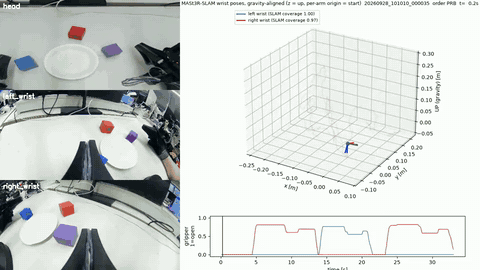
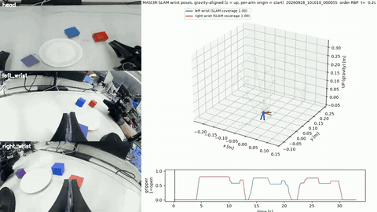
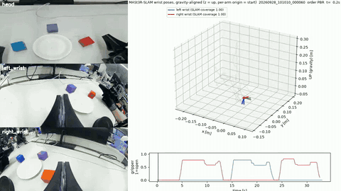

# Release history

> **2026-11-05 refactor.** This is a historical record: paths in it are those of its date. Current locations: [`docs/refactor_2026-11.md`](refactor_2026-11.md) (old → new map) and [`archive/README.md`](../archive/README.md).

Release-by-release narrative of this repository, moved verbatim from the README on 2026-11-01 so that the README keeps
to one page. Numbers and wording are unchanged; only relative links were adjusted for this file's location.
`analysis/verify_claims.py` checks the README values in the README and this file together.

Path notes (2026-11-01): `docs/media/` is now [`media/`](../media/); the C-old v1 dataset builder (`scripts/rebot/dataset/`)
and `scripts/rebot/loaders/legacy/` are now in [`legacy/`](../archive/README.md). The laundry / garment material named below
(`src/visual_teleop/`, `scripts/umi_teleop_eval/`, `scripts/rebot/laundry/`, `scripts/rebot/parity/`) moved to [egocentric-garment-manipulation](https://github.com/physical-ai-robot-learning/egocentric-garment-manipulation).
Release tags: `report-v2-2026-09-30`, `report-v3-2026-10-04`.

- [Update v2: multi-seed retargeting, robot-like collection, combined dataset](#update-v2-multi-seed-retargeting-robot-like-collection-combined-dataset)
- [Update v3: Cartesian ego pretraining and transfer](#update-v3-cartesian-ego-pretraining-and-transfer)
- [Update v4: two reports, R30 ablation and single-arm approach](#update-v4-two-reports-r30-ablation-and-single-arm-approach)
- [Repository maps by release (historical)](#repository-maps-by-release-historical)

### Update v2: multi-seed retargeting, robot-like collection, combined dataset

The first release used a single-anchor retarget ("v1"). Every segment started from one robot posture, so v1 lost
most segments at the workspace gate and collapsed the pseudo-joint starts onto one posture. v2 changes the retargeting
and adds a second, robot-like collection. Nothing in the first-release dataset was modified.

**Status: offline only.** The v2 ego pretrain on the 996-segment dataset was stopped by us at 211.7k of 300k planned
steps; the 100k (primary) and 200k checkpoints are kept (`results/finetune/C_OLD_TR_HANDOFF.json`). No robot
fine-tuning result from them is reported. The fine-tuning comparison below uses the **v1** ego pretrain.

#### Retarget v2 under an R30-only contract

Every quantity taken from real robot data (seed-bank bounds, workspace gate, manifold penalty, TR window library) comes
from 30 robot episodes (R30) only. R30 is part of every later fine-tuning subset. Evaluation uses the remaining 120
robot episodes (held-out R120). Results on the old 259 source episodes (1,229 candidate segments):

| method | usable | posture NN to held-out R120, p50 / p90 (rad) | W1 \|dq\| vs held-out |
|---|---|---|---|
| v1 single anchor | 36.5 % | 1.494 / 1.551 | 0.00197 |
| v2-K kinematic multi-seed | 66.6 % | 1.206 / 1.599 | 0.00275 |
| v2-Kr + manifold penalty | 67.0 % | 0.441 / 0.738 | 0.0031 |
| v2-TR R30 window retrieval | 56.1 % | 0.272 / 0.454 | 0.00208 |

- TR is the primary method. It gives the closest postures but fails more segments; almost all of its failures are
  `no_workspace_window`.
- On the 686 segments that both TR and Kr solve, TR's velocity W1 advantage is small (0.00207 vs 0.00226). Most of the
  dynamics gap in the table comes from which segments each method keeps. The posture gain holds on the matched set.
- The hybrid master (TR if feasible, else Kr) was frozen before HRL80 was retargeted. The primary pretrain set uses TR
  segments only; hybrid-all is kept as an ablation.

Code: `src/rebot_prep/retarget/`. Frozen contracts: `src/rebot_prep/retarget/contracts/`. Results: `results/retarget_v2/`.

#### Robot-like collection (protocol `robot_like_v1`, dataset HRL80)

The protocol runs inside the existing collector (`--protocol robot_like_v1`). It uses 30 s AUTO episodes and a live
panel of wrist rotation speed and acceleration against reBot R150 p95 levels, and tracks grasp stages. After each
session, an offline MASt3R → IK robot-feasibility check runs. Without the flag, the collector behaves exactly as in the
first release.

- HRL80 = 60 episodes, 10 per order, in one session on 2026-09-28 with one operator. The target was 14 per order.
- Retargeted with the same frozen pipeline: TR 58.9 % (old259: 56.1 %), Kr fallback 15.5 % (11.2 %), none 25.5 %
  (32.7 %); hybrid usable 74.5 % (67.3 %).
- HRL80 wrist rotation speed was lower than old259's (median over-p95 fraction 0.067 vs 0.144), but per-episode
  TR feasibility did not change (0.59 vs 0.592). The live metric does not track feasibility: Spearman ρ −0.10 old259,
  −0.17 HRL80, −0.11 pooled. The pre-registered reading that fits is "live up, offline flat". The workspace remains the
  main failure. The two groups differ in session and scene as well as protocol, so any difference is only associated
  with the protocol, not shown to be caused by it. We read this as a negative, diagnostic result: collection style is
  not what limits retarget yield.

Code: `src/handumi_collector/robotlike/`, `scripts/robotlike_*`, `configs/handumi/robot_like_v1.yaml`,
`docs/collector/ROBOT_LIKE_PROTOCOL.md`. Results: `results/hrl80/`.

#### C-old v2 dataset (final, frozen)

- 996 TR segments of 65 frames each: old 689 plus HRL80 307.
- Split: train 896 / val 100, taken by source episode (284 / 32).
- Chunk starts: 27,776 train / 3,100 val.
- Val = the first release's 26 held-out episodes + HRL80 episodes 49–54, one round of all six orders. Report these two
  val groups separately.
- The old segments are appended unchanged. Rows, task strings and every decoded video frame are verified identical to
  the frozen old259 snapshot (invariants I0–I5).

Builders and validators: `scripts/rebot/dataset_v2/`. Metadata and manifests (no video or parquet data): `results/dataset_v2/`.

#### Ego pretrain → robot fine-tuning (v1 ego pretrain)

At 250k steps of R150 fine-tuning, the model initialised from the v1 ego pretrain beats scratch (`lerobot/xvla-base`,
same recipe) by a small margin on most metrics:

| metric | geo | motion geo | k30 FK p50 | motion k30 MAE |
|---|---|---|---|---|
| C-old vs scratch | −10.0 % | −7.2 % | −4.1 % | −6.8 % |

- Episode-level paired bootstrap (10k draws, `analysis/paired_bootstrap_r150.py`): geo 95 % CI −14.7 to −5.6 %,
  motion geo −13.4 to −1.8 %, motion k30 MAE −12.7 to +0.5 %; 8 of 10 episodes favour the ego init.
- Episodes 66/77, motion geo: C-old is worse (+4.2 %).
- **All 10 evaluation episodes are in the R150 fine-tuning data of both arms.** This comparison measures fit to seen
  episodes, not generalisation.
- R90 was stopped early and compared at only 2 matched steps (10k, 20k). Signs are mixed: C-old is better on all-sample
  geo (−33 %, −11 %) and worse on motion geo (+2 %, +13 %). There is no conclusion. R60 (scratch arm only) and R30
  (≤ 20k steps) were also stopped; `results/finetune/RUN_STATUS.json` lists every run's final state. None is running.

Records: `results/finetune/`. The v2 pretrain launch record is `results/finetune/FINAL_TR300K_LAUNCH.json`.

### Update v3: Cartesian ego pretraining and transfer

Retargeting to robot joints removed a third to a half of the human motion and produced a joint-space target that our robot
policies are not trained in. Version 3 converts whole human episodes directly into the robot's own relative-Cartesian
action contract, then tests what transfers. Report sections X–XIII. Run status for every v3 run:
`results/v3/RUN_STATUS_v3.json`.

**Status:** training diagnostics, plus one unlogged closed-loop observation. Checkpoints were executed on the robot
(`results/v3/hardware_cycles_by_ckpt.csv`: 71 checkpoints, 49,431 control cycles); the log records IK tracking, not task
outcome. The operator observed complete three-cube stacks with the ego-initialized R312c model (B300, checkpoints
75k–205k). Trials were not counted and there is no video, so this is a demonstration, not a success rate, and no scratch
model on the same data was tested the same way.

#### Data contract and dataset (`src/ego_cart20/`)

- Rows at 15 Hz. Action = 16 future poses `inv(T(t)) @ T(t + k·50.05 ms)`, k = 1..16 (0.80 s), interpolated on the raw
  30 Hz track. Per arm xyz + 6-D rotation + gripper = CART20; the model's 32-D action is padded with 12 exact zeros.
- State = each arm's pose relative to its task start + both grippers (same layout as the robot data). Gripper =
  continuous aperture / 80 mm (max observed 0.847).
- No workspace or IK filtering. 330 episodes (273 original + 57 HRL80; 3 refused for invalid IMU scale).
  111,533 rows at 15 Hz, of which 57,283 (51.4 %) are trainable.
- Frozen split: train 298 episodes / 51,612 rows, val 32 / 5,671.
- **Silent pose jumps.** 57 % of apparent > 30 mm state jumps (1,482 / 2,598) were time gaps between exported rows. The rest
  are MASt3R-SLAM translation jumps without a tracking-lost flag (55 raw steps > 3 m/s in 24 training episodes). The v2b filter
  acts on 44 events in 42 episodes → **train 297 / 48,411 rows (−6.20 %)**, val unchanged; max adjacent step 422.5 → 90.5 mm.
- Contract tests: `tests/cart20/test_contract.py` (11 tests, all pass).

Evidence: `results/v3/ego_cart20/`, `results/v3/state_jump/`.

#### MASt3R-SLAM trajectory videos

Bimanual HRL80 takes. Left: head camera and both wrist fisheye cameras. Right: gravity-aligned MASt3R-SLAM wrist
trajectories (z up, each arm's origin at its start, current tool axes drawn) with IMU visual–inertial metric scale, and
both grippers below (1 = open). Click a preview for the MP4 (960×540).

<table>
<tr><td align="center" width="50%"> HRL80 stacking, order PRB (33 s, shown 3×)</td><td align="center" width="50%"> HRL80 stacking, order RBP (33 s, shown 3×)</td></tr>
<tr><td align="center" width="50%"> HRL80 stacking, order PBR (33 s, shown 3×)</td><td></td></tr>
</table>

Renderer: `analysis/v3/viz_mast3r_episode.py`.

#### Ego vs robot, and the soft-prompt audit

- Robot IK reaches 99.7 / 99.5 % of ego positions (L / R) and 72.3 / 74.6 % of full ego poses. The deployed IK
  (one wrist joint locked) reproduces only 45.2 / 52.2 % of the robot's **own** poses.
- Wrist-image sharpness (Laplacian variance, p50): ego 1,854 / 1,487 vs robot 59 / 64
  (`results/v3/robotized/wrist_sharpness_val.json`).
- **X-VLA soft-prompt slots:** only slots 10–17 of `lerobot/xvla-base` were ever trained. Ids 0 and 6, both used by our
  earlier runs, were untrained. Initial loss on R312c: slot 0 1.11, 6 1.12, 15 1.61, 10 2.35, 16 2.65, 17 4.07, 11 22.80.
  All v3 runs use unused slot 20. Evidence: `results/v3/domain_slots/`.

#### Transfer diagnostics

| test | result | evidence |
|---|---|---|
| Ego-only 40k on 120 robot frames, k8 direction cosine (L / R) | −0.05 / −0.03 (robot-trained 40k: +0.81 / +0.77, in-training frames) | `results/v3/diagnostics/direction_cosine_ego40k_vs_robot40k.txt` |
| Same, best of 12 L↔R swap × axis-flip variants | max +0.16 (not a convention error) | `…/direction_cosine_flip_swap.txt` |
| Image/state swap: ego images + any state | 0.69–0.90 | `…/image_state_ablation_ego40k.txt` |
| Image/state swap: robot images + any state | −0.25 to +0.49 → the gap is visual | same |
| Ego init (50k) vs scratch, R312c fine-tuning loss, identical data/schedule/seed | step 200: 0.244 vs 0.945; B/A 0.49 (0–5k), 0.875 (5–20k), 0.95 (20–40k), 0.984 (55–60k, tie) | `analysis/out/v3_ego_init_loss.json`, `results/v3/loss_curves/` |

- The diagnostic outputs were captured from the session log (the runs wrote no file); each text file says so and names the
  script in `analysis/v3/`.
- The loss comparison is training loss with one seed per arm. The two finished 300k runs used **different robot datasets**
  (R312c vs R384), so they are not a transfer comparison.
- **Robotized wrist** (`src/ego_cart20/scripts/export_lerobot_robotized.py`): fisheye → virtual pinhole (hfov 62–70°,
  jaws low), blur, JPEG. ROBOT100 (all frames) sharpness 181 / 132, still 2–3× the robot. The MIX70 pretrain was stopped at 5k.
  Co-training (4 ego + 4 robot per batch, `src/training/relonly/train_cotrain.py`) was stopped at 88.6k without evaluation. The
  The ROBOT100 300k pretrain finished on 10-05 (loss 0.007); its 100k and 300k checkpoints initialize the R30 ablation (v4).

#### HRA_red: right-hand approach with cube-based scale

- 200 right-hand takes of "approach the red cube". The IMU visual–inertial scale is unobservable on these slow motions: median
  0.012, ≤ 0 in 95 of 200 episodes.
- **Cube PnP scale** (`src/ego_cart20/cube_pnp.py`, edge 3.8 cm). Validated on HRL80 takes, where the IMU is reliable:
  37 / 57 valid, PnP/IMU median 1.062 (p16–p84 0.959–1.274).
- Funnel 200 → 181 (scale gates) → 166 (physical sanity). Train 151 episodes / 20,319 rows; val 15 / 2,011.
- Loss-masked training (left arm and gripper masked; 9 / 20 dims supervised; `src/training/relonly/rel16_relonly_lossmask.py`).
  The 300k run finished on 10-05 (training loss 0.002).
- Held-out loss at 15k: 0.150 vs train-subset 0.066, rising to 0.299 at 105k: the model overfits 151 episodes.
- Robot runs (8,397 cycles on 10-04) logged no outcome. Everything after v3 on this task is in Part II (v4).

Evidence: `results/v3/hra_red/`.

### Update v4: two reports, R30 ablation and single-arm approach

#### Part I: low-data ablation on 30 robot episodes

Three otherwise identical fine-tuning runs on **R30** (R312c episodes 150–179, 17,600 frames), 600k cosine schedule, from
the base model (scratch) and from the ROBOT100 ego pretrain at 100k and 300k steps. Training loss only, one seed per arm;
the 100k-init and scratch ran on an RTX 4090 (torch 2.6), the 300k-init on an RTX 5090 (torch 2.7.1).

| window | ego-PT 100k init / scratch | ego-PT 300k init / scratch |
|---|---|---|
| 1k–5k | 0.544 | 0.493 |
| 10k–20k | 0.823 | 0.697 |
| 50k–100k | 0.970 | 0.856 |
| 100k–150k | 1.021 | 0.914 |

Both ego initializations start below half the scratch loss; the advantage is gone by ~100k (100k-init) and ~200k
(300k-init). All three runs were stopped (471k / 305k / 310k, 139–214 epochs): every arm memorizes 30 episodes. **No R30
checkpoint has been run on the robot and there is no held-out robot evaluation**, so this is not a transfer result. The
trial logger in the deployment UI exists but has recorded no trial. Evidence: `results/v4/loss_curves/`,
`results/v4/r30_ablation_summary.json`, `results/v4/RUN_STATUS_v4.json`.

#### Part II: single-arm approach (HRA_red → robot camera rendering → HRA_A100)

- **Robot-side calibration:** head C922 (checkerboard, RMS 1.05 px), robot right-wrist hand-eye (13 views, 0.16 px RMS; camera
  169.5 mm behind the TCP, optical axis 33° below TCP x). The IK stack's TCP lies ~82 mm ahead of the physical jaw tip; contact
  now uses the URDF fingertip box.
- **robotcam v2:** wrist frames re-rendered with the measured robot camera (hfov 52°), labels as robot-TCP poses via hand-eye.
- **HRA_A100 protocol:** every take starts with the HandUMI jaw tip held 2 s on a taped cross that the robot jaw tip also
  touched → shared task frame G (3-point line fit, collinearity 0.38 mm; table z −27.1 mm). Scale from cube PnP or the table
  plane at the origin (ratio to PnP 0.999); origin yaw measured per take.
- **Table-aware conversion** (fingertip floor = table + 5 mm): CT5/CT6 keep 86 of 107 takes, clearance p50 12.6 mm, min 7.6 mm.
- **Training:** start- vs origin-anchored state give the same held-out loss (0.124 vs 0.132 at 5k); every run overfits from the
  first checkpoint.
- **Robot:** 192 planned-execution sessions on 10-06/07; on 10-07, 69 of 127 ended on a cube-size stop (a proximity proxy, not
  contact). **No trial outcome was logged; no success rate.**

Evidence: `results/v4/hra/` (validation losses, calibration files, table-aware reports, start poses, plan-session summary).

### Repository maps by release (historical)

What each release added, with paths updated to the current layout.

#### v2 additions

| dir | contents |
|---|---|
| `src/rebot_prep/retarget/` | seed bank, v2-K / v2-Kr / v2-TR retarget, held-out comparison, hybrid merge, HRL80 prereg report, chain scripts; `contracts/` = frozen rules, R30 list, splits, prereg, gripper contract, seed banks |
| `scripts/rebot/dataset_v2/` | TR / hybrid / HRL80 LeRobot builders, final append, validators, append-invariant checker, env-driven `write_stage.py` |
| `src/handumi_collector/robotlike/`, `scripts/robotlike_*`, `tests/collector/`, `docs/collector/` | robot-like protocol monitor, offline check and group comparison, tests, protocol doc |
| `results/retarget_v2/`, `results/hrl80/`, `results/dataset_v2/`, `results/finetune/` | comparison JSONs, frozen master manifests, HRL80 census and prereg report, dataset manifests and gates, fine-tuning evals and summaries |
| `docs/NUMBERS_v2.md`, `docs/SOURCES_v2.md`, `docs/FINAL_CLAIMS.md` | every v2 number with its file and key; source mapping; headline claim table with evidence and status |

#### Code added on 2026-10-07

The full working code of the project was added, so the repository is no longer only the audited subset:

| path | contents |
|---|---|
| `src/handumi_collector/`, `firmware/`, `configs/` | latest `handumi_collector` (robot_like_v1, HRA_red, HRA_A100 origin protocol, C922-view tile), firmware, calibration configs; imports `ego_collector.camera` |
| `scripts/rebot/hra/` | single-arm approach pipeline: base-frame linking, robot camera and hand-eye calibration, robotcam v2 rendering, origin-plane scale, origin yaw, G frame, table-aware QP, held-out evaluation |
| `src/rebot_deploy/`, `scripts/rebot/loaders/` | inference core, robot UI (PLAN/RTC/cube-size stop/trial logger), Pink IK, checkpoint loaders, MIT robot service |
| `hardware/` | HandUMI print package (3MF/STL) from upstream [murobotics-ai/handumi-hw](https://github.com/murobotics-ai/handumi-hw) (not our design), our modified parts (`mods/`) and build notes; our build copy is [physical-ai-robot-learning/umihand](https://github.com/physical-ai-robot-learning/umihand) |
| `src/ego_teleop/`, `src/ego_collector/`, `scripts/body_*`, `src/visual_teleop/`, `scripts/umi_teleop_eval/` | wearable teleop (VIO), AprilTag V0 collector, RGB-D body tracking, (10-20) `visual_teleop` HandUMI teleop and wrist-tracking evaluations |
| `scripts/rebot/laundry/`, `scripts/rebot/parity/` | (10-20) UMIalign pose + visual-gripper pipeline; UMI TCP tag-rig calibration, Kalibr, UMI → reBot replay parity |
| `upstream/` | patch and new files on top of murobotics-ai/handumi-sw (formerly robonet-ai; Apache-2.0) |
| `scripts/training/`, `scripts/training/archivers/`, `src/training/umi76/` | node launchers (4090 / 5090), archivers, base widening |
| `docs/OPERATIONS_NOTES.md` | conventions and pitfalls (gripper signs, TCP frames, PLAN settings, GPU rules) |

Path placeholders that had been substituted for the public release were restored to the real working paths, and the reBot
URDF and MASt3R build patch are included. Many scripts hard-code the roots they ran from; the MANIFEST files in `docs/provenance/` list
the source of every file. Datasets and checkpoints are still not included. `physical-ai-robot-learning/umihand` holds the hardware only (print files, modified parts,
STEP, BOM, IMU firmware).

#### Repository map additions (v4)

| path | contents |
|---|---|
| `report/part{1,2}_*_{en,ko}.{tex,pdf}` | the four v4 short reports; `report/archive/` = full-length v4 versions and v3 |
| `analysis/v4_r30_ablation.py` | R30 matched-step comparison + Fig. 8 |
| `analysis/v4_hra_summary.py` | Part II numbers (validation loss, table-aware tallies, G frame, hand-eye) + Fig. 9 |
| `results/v4/` | loss curves (ROBOT100 pretrain, three R30 arms), R30 summary, run status, `hra/` evidence |

#### Repository map additions (v3)

| dir | contents |
|---|---|
| `src/ego_cart20/`, `tests/cart20/` | Cartesian ego package: contract (`config.py`), geometry, interpolation, jump filter, label builders, converter, validators, LeRobot exporters (plain, robotized-wrist, right-only), cube PnP scale, right-only conversion + sanity gate, ego-vs-robot and IK compatibility reports; `tests/` (contract, cube scale, right-only) |
| `src/training/relonly/` | REL-only loss plugin (dims 20:32 zeroed), per-dim loss-mask variant + tests, AdamW8bit wrapper with a checkpoint-save shim, exact 4 + 4 ego/robot co-training sampler |
| `analysis/v3/` | loss-curve extraction and the matched init comparison, direction-cosine and image/state-swap diagnostics, wrist optical-flow axis check, soft-prompt slot audit + init-loss probe, wrist sharpness, HRL80 PnP-vs-IMU validation, HRA held-out loss, hardware cycle counts |
| `results/v3/` | dataset metadata and integrity reports, jump root cause, ego-vs-robot statistics, slot audit, robotized export records, loss curves, diagnostics, HRA QC (per-episode scale records), run status |
| `report/figures/make_figures_v3.py` | Figs. 4–5 of the report |

v3 code imports some internal packages that are not included: the HandUMI raw-episode exporter (`sources/handumi_export.py`),
the deployment/inference client (`infer_core_v4`) used by the diagnostics, and the robot datasets. HRA_red videos and frames are not published.

#### First release

| dir | contents |
|---|---|
| `src/handumi_collector/`, `configs/handumi/` | HandUMI collector (`handumi_collector/`: devices, recorder, session/auto-loop, PySide6 UI, calibration and QA tools) and `configs/handumi/{tasks,hardware_handumi_v1}.yaml` |
| `configs/dataset_calibration/` | Calibrations used for this dataset: fisheye intrinsics (L v002, R v003), camera-IMU extrinsics (L v001, R v002, plus the Kalibr result files in `kalibr/`), head C922 intrinsics v003, `camera_tcp/handumi_camera_tcp_v2.yaml`, the TCP convention and the gripper tick calibrations that the episodes reference (`gripper/`) |
| `scripts/rebot/c8/` | Episode export to the raw_video + imu_data layout (`umi_export_orbslam.py`, `c8_export*.sh`) |
| `src/mast3r_pose/` | Per-frame MASt3R-SLAM wrapper (`run_perframe*.py`), the sm_120 build patch, the pinned upstream commit and checkpoint MD5s, run scripts, and IMU-VI metric scale (`cp6_scale.py`) |
| `src/rebot_prep/grip/` | Gripper width from raw jaw ticks (aperture 0.0675 m): `extract_grip.py`, `correct_grip.py`, `c8_grip.py` |
| `src/rebot_prep/census/` | Census and gates: `c8_census_pre.py` (sensor/sync), `c8_phase3.py` (pose -> metric TCP -> pseudo-q, 65-frame segments), collision, gravity-sign and regression checks |
| `src/rebot_prep/pseudo_joint/` | Retarget + continuity IK core (`pseudo_joint_pipeline.py`), state layout, input-quality gate, IK wrapper `eef_kin.py` |
| `legacy/c8old_dataset_v1/` | Segment rows -> LeRobot v3 dataset (`c8old_build_dataset.py`, `write_stage.py`), post-build and gripper-semantics gates |
| `scripts/training/c8old/`, `src/training/robot/` | `train_bi.py` (LeRobot X-VLA entry point with install hooks), `humanik_delta.py` (Δq target, EEF aux and FK losses), `c8old_chain.sh` (smoke -> 300k pretrain -> integrity -> robot fine-tune), `c8old_launch.sh`, and `robot/` (reBot URDF, numpy/torch FK) |
| `scripts/rebot/eval/c8old/` | Offline checkpoint evaluator (`c8old_mac_eval.py`), frame cache and checkpoint selection |
| `results/` | `episode_manifest.csv` (349 episodes: session, order, time, domain, funnel outcome, split), `model_config/` (X-VLA `config.json`, `train_config.json`), `pose_benchmark/`, census/funnel JSONs, domain manifest, quarantine list, gripper census, split index, run provenance/summary, per-checkpoint eval JSONs (`eval/`, `eval_gated/`) and `selection.json` |
| `sample_data/` | 3 episodes (see below) |
| `analysis/` | `verify_claims.py` recomputes every number in the report and this README from the files in this repo (see `analysis/out/claim_audit.md` for the count; table in `analysis/out/claim_audit.md`). Post-hoc analyses of the final checkpoint: `prompt_swap.py` (6 order instructions, same noise seed, + 2 extra seeds), `summarize_prompt_swap.py`, `per_order_breakdown.py`; summaries in `analysis/out/*.json` |
| `report/` | Technical reports (Part I stacking, Part II approach; English + Korean; PDF + LaTeX) and figure scripts |
